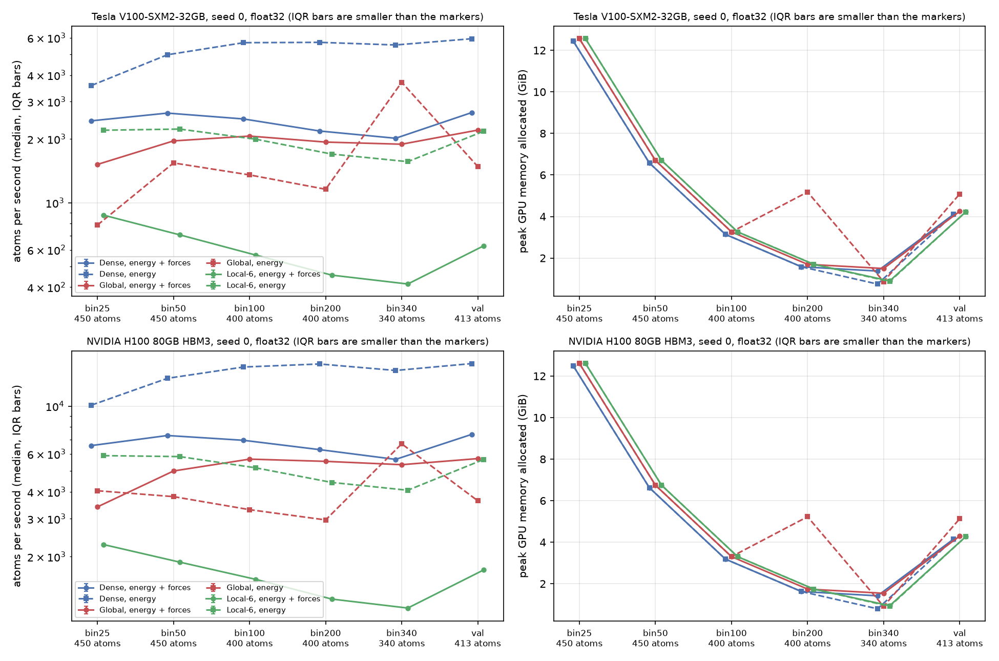

# Inference timing: Dense, Global and Local-6 on the same GPU

Date: 2026-10-18. Jobs 49443920 (V100-32), 49443929 (H100-80) and 49445369 (kernel profile, V100-32) on Bridges-2. Branch `timing`. Author: Anshul Kumar (11-785 Team 6).

## 1. Question

The mentors asked for speed and memory next to accuracy. The pilots recorded a training throughput, but Dense and Global trained on V100 GPUs and Local-6 trained on an H100. So those numbers do not compare the models. This report measures the inference cost of all three final pilot checkpoints on the same GPU type, in the same job. It answers four questions:

- Q1. Is Local-6 slower than Global at inference, and by how much?
- Q2. Does the ratio depend on the structure size?
- Q3. How much GPU memory does each model use?
- Q4. What do the forces cost on top of the energy?

## 2. Method

### 2.1 What we time

`scripts/inference_timing.py run` loads one checkpoint at a time with `load_predict_unit`. It uses the settings of `docs/router-check.md`: EMA weights, float32, the `general` backend, Euler-angle Wigner matrices as in the checkpoint, and no stress task. The graph is built on the GPU inside the model, with the 6 A cutoff and 300 neighbours. For each input batch the script times three calls:

- `graph`: `backbone._generate_graph` alone. This is the radius graph that the model builds at the start of every forward pass.
- `energy`: one model forward under `torch.no_grad`, with the forces head switched off (`regress_config.forces = False`).
- `energy_forces`: one model forward with the forces from autograd. This is the validation path, because the pilots use `direct_forces: false`.

The `energy` and `energy_forces` times include the graph. The script checks on every input that the `energy` path gives the same energy as the `energy_forces` path (tolerance 1e-4) and that the forces are finite.

### 2.2 What we do not time

The batch is on the GPU before the clock starts. We do not time the host-to-device copy, the reading of the data, the denormalisation, the element references or the copy of the result to the CPU. We do not use `torch.compile`, TF32, CUDA graphs or the fairchem `merge_mole` option.

### 2.3 Inputs

All inputs come from `manifests/pilot_val_5k.txt` (5,000 validation rows). The selection is deterministic:

- Size bins. For a target size t in 25, 50, 100, 200 and 340 atoms, the script takes the structures whose atom count is closest to t (ties go to the lower row). It takes at most 450 // t structures and stops before the batch passes 450 atoms. The largest validation structure has 349 atoms, so no 400-atom bin exists.
- `val`. The first 4 validation batches in row order, with at most 450 atoms per batch, as in validation. They hold 18 structures and 1,651 atoms (413 atoms per batch on average).

| Condition | Structures | Atoms per batch | Edges per batch | Edges per atom |
|---|---:|---:|---:|---:|
| bin25 | 18 | 450 | 9,038 | 20.1 |
| bin50 | 9 | 450 | 12,808 | 28.5 |
| bin100 | 4 | 400 | 14,936 | 37.3 |
| bin200 | 2 | 400 | 19,016 | 47.5 |
| bin340 | 1 | 340 | 17,896 | 52.6 |
| val | 18 in 4 batches | 413 | 13,808 | 33.5 |

### 2.4 Timer and statistics

Each call gets 5 warm-up calls first. Then the script times 25 calls. It calls `torch.cuda.synchronize()` before and after every timed call and reads `time.perf_counter()`. The script makes a fresh copy of the batch outside the clock for every call. We report the median and the interquartile range (IQR) of the time per batch. Atoms per second is the atoms per batch divided by the time. The script resets `torch.cuda.reset_peak_memory_stats()` before each condition and mode and reads `torch.cuda.max_memory_allocated()` after it. Seeds are fixed (`torch.manual_seed(0)`), and inference is deterministic in its inputs. One process uses one GPU. Each model runs alone; the next model loads only after the last one is deleted.

### 2.5 Kernel profile

The timing showed that Global is slower with energy only than with forces. To find the cause, `scripts/inference_timing.py profile` runs the seed 0 checkpoints on bin100 under `torch.profiler`. It adds a third energy mode, `energy_grad`: the forces head is off, but autograd records the graph (no backward pass). Job 49445369 ran it on one V100-32. The output is in `results/inference_timing_profile_v100.txt`.

## 3. Setup

| Item | V100 job | H100 job |
|---|---|---|
| Job id | 49443920 | 49443929 |
| Job file | `slurm/inference_timing_v100.job` | `slurm/inference_timing_h100.job` |
| GPU (from the job's own output) | Tesla V100-SXM2-32GB, driver 580.178.04 | NVIDIA H100 80GB HBM3, driver 610.57.04 |
| Node | v014 | w007 |
| Partition, account | GPU-shared, `che260063p` | GPU-shared, `che260063p` |
| Other processes on the GPU at start | 0 | 0 |
| Jobs on the node (all users) at start and end | 7 and 7 | 5 and 5 |
| Elapsed (`sacct`) | 29 min 28 s | 14 min 14 s |
| State | COMPLETED, exit 0 | COMPLETED, exit 0 |
| Service units | 0.491 (our calculation: 1,768 s x 1 SU per V100 GPU-hour) | 0.474 (`job_info` SuCharged) |

The profile job 49445369 ran on node v012 (V100-32) for 4 min 42 s, COMPLETED, about 0.078 SU (our calculation). The three jobs used about 1.04 SU in total. `job_info` did not list jobs 49443920 and 49445369 yet.

Software on both nodes: torch 2.8.0+cu128 (CUDA 12.8), fairchem-core 2.21.0, Python 3.12.15. `torch.backends.cuda.matmul.allow_tf32` was False, `cudnn.allow_tf32` was True (no convolution runs), and the float32 matmul precision was `highest`. The code ran from `shared/repo_timing/AI4Science-MLIPs`, synced from this branch (`b2.py syncrepo`, 185 files identical by SHA-256).

Checkpoints: the final inference checkpoint of each pilot, `runs/pilot_<variant>_s<seed>_<jobid>/train/<id>/checkpoints/final/inference_ckpt.pt`, seeds 0, 1 and 2, all nine runs.

Parameters, counted from the loaded models:

| Model | Total parameters | Active per structure | Edge chunk for activation checkpointing |
|---|---:|---:|---:|
| Dense | 5,981,057 | 5,981,057 | 131,072 |
| Global | 37,652,265 | 5,998,377 | 131,072 |
| Local-6 | 37,652,265 | 5,998,377 | 4,096 |

The counts equal the values in `docs/TRAINING.md`. The active count keeps one of the 8 expert slices of every MoLE layer.

## 4. Results

`results/inference_timing_v100.csv` and `results/inference_timing_h100.csv` hold 162 rows each (3 models, 3 seeds, 6 conditions, 3 modes). Times are the median per batch in ms, with the IQR in brackets. Memory is the peak allocated memory in GiB.

### 4.1 V100-32, seed 0

| Condition | Atoms | Edges | Mode | Dense ms (IQR) | Global ms (IQR) | Local-6 ms (IQR) | Dense atoms/s | Global atoms/s | Local-6 atoms/s | Dense GiB | Global GiB | Local-6 GiB |
|---|---|---|---|---|---|---|---|---|---|---|---|---|
| bin25 | 450 | 9038 | graph | 95.0 (94.9 to 95.1) | 94.8 (94.7 to 94.8) | 94.9 (94.8 to 94.9) | 4,738 | 4,748 | 4,742 | 12.44 | 12.56 | 12.56 |
| bin25 | 450 | 9038 | energy | 125.9 (125.8 to 126.0) | 572.9 (572.8 to 573.0) | 204.7 (204.6 to 204.9) | 3,574 | 785 | 2,199 | 12.44 | 12.56 | 12.56 |
| bin25 | 450 | 9038 | energy_forces | 184.8 (184.7 to 184.9) | 296.7 (296.7 to 296.8) | 514.8 (514.3 to 515.3) | 2,435 | 1,517 | 874 | 12.44 | 12.56 | 12.56 |
| bin50 | 450 | 12808 | graph | 50.5 (50.4 to 50.5) | 50.5 (50.4 to 50.5) | 50.6 (50.5 to 50.6) | 8,919 | 8,911 | 8,900 | 6.58 | 6.70 | 6.70 |
| bin50 | 450 | 12808 | energy | 90.2 (90.1 to 90.3) | 292.0 (292.0 to 292.1) | 202.2 (201.9 to 202.4) | 4,989 | 1,541 | 2,226 | 6.58 | 6.70 | 6.70 |
| bin50 | 450 | 12808 | energy_forces | 169.9 (169.9 to 170.1) | 229.8 (229.7 to 229.9) | 637.3 (636.6 to 638.4) | 2,648 | 1,958 | 706 | 6.58 | 6.70 | 6.70 |
| bin100 | 400 | 14936 | graph | 26.3 (26.3 to 26.4) | 26.4 (26.3 to 26.4) | 26.4 (26.4 to 26.5) | 15,205 | 15,164 | 15,139 | 3.14 | 3.26 | 3.26 |
| bin100 | 400 | 14936 | energy | 70.3 (70.3 to 70.4) | 295.6 (295.6 to 295.7) | 200.6 (200.1 to 200.9) | 5,687 | 1,353 | 1,994 | 3.14 | 3.26 | 3.26 |
| bin100 | 400 | 14936 | energy_forces | 161.0 (160.9 to 161.0) | 193.9 (193.8 to 194.0) | 705.8 (705.1 to 707.0) | 2,485 | 2,063 | 567 | 3.14 | 3.26 | 3.26 |
| bin200 | 400 | 19016 | graph | 15.9 (15.8 to 16.0) | 16.0 (15.9 to 16.0) | 16.0 (16.0 to 16.1) | 25,128 | 25,068 | 24,963 | 1.58 | 1.70 | 1.70 |
| bin200 | 400 | 19016 | energy | 70.1 (70.0 to 70.2) | 345.4 (345.3 to 345.5) | 235.7 (235.4 to 236.4) | 5,708 | 1,158 | 1,697 | 1.58 | 5.18 | 1.70 |
| bin200 | 400 | 19016 | energy_forces | 183.5 (183.4 to 183.7) | 207.0 (206.9 to 207.0) | 877.6 (876.8 to 878.1) | 2,180 | 1,933 | 456 | 1.58 | 1.70 | 1.70 |
| bin340 | 340 | 17896 | graph | 10.1 (10.0 to 10.2) | 10.1 (10.0 to 10.1) | 10.2 (10.1 to 10.2) | 33,585 | 33,597 | 33,428 | 0.75 | 0.87 | 0.87 |
| bin340 | 340 | 17896 | energy | 61.3 (61.2 to 61.4) | 91.9 (91.7 to 92.0) | 217.6 (217.1 to 217.8) | 5,548 | 3,702 | 1,563 | 0.75 | 0.87 | 0.87 |
| bin340 | 340 | 17896 | energy_forces | 168.8 (168.7 to 168.8) | 180.0 (179.9 to 180.1) | 821.4 (820.9 to 822.0) | 2,015 | 1,889 | 414 | 1.37 | 1.50 | 0.90 |
| val | 413 | 13808 | graph | 27.7 (27.7 to 27.7) | 27.7 (27.7 to 27.7) | 27.8 (27.7 to 27.8) | 14,904 | 14,894 | 14,870 | 4.10 | 4.22 | 4.22 |
| val | 413 | 13808 | energy | 69.5 (69.5 to 69.5) | 278.5 (278.4 to 278.5) | 189.6 (189.5 to 189.8) | 5,938 | 1,482 | 2,177 | 4.10 | 5.08 | 4.22 |
| val | 413 | 13808 | energy_forces | 155.0 (155.0 to 155.1) | 187.5 (187.5 to 187.5) | 658.2 (657.9 to 659.0) | 2,663 | 2,201 | 627 | 4.10 | 4.25 | 4.22 |

Ratios of the median time per batch, V100, seed 0:

| Condition | Mode | Local-6 / Global | Global / Dense | Local-6 / Dense | Local-6 / Global peak memory |
|---|---|---:|---:|---:|---:|
| bin25 | energy | 0.36 | 4.55 | 1.63 | 1.00 |
| bin25 | energy_forces | 1.73 | 1.61 | 2.79 | 1.00 |
| bin50 | energy | 0.69 | 3.24 | 2.24 | 1.00 |
| bin50 | energy_forces | 2.77 | 1.35 | 3.75 | 1.00 |
| bin100 | energy | 0.68 | 4.20 | 2.85 | 1.00 |
| bin100 | energy_forces | 3.64 | 1.20 | 4.38 | 1.00 |
| bin200 | energy | 0.68 | 4.93 | 3.36 | 0.33 |
| bin200 | energy_forces | 4.24 | 1.13 | 4.78 | 1.00 |
| bin340 | energy | 2.37 | 1.50 | 3.55 | 1.00 |
| bin340 | energy_forces | 4.56 | 1.07 | 4.87 | 0.60 |
| val | energy | 0.68 | 4.01 | 2.73 | 0.83 |
| val | energy_forces | 3.51 | 1.21 | 4.25 | 0.99 |

The graph ratios are 1.00 to 1.01 for every condition (all three models build the same graph).

### 4.2 H100-80, seed 0

| Condition | Atoms | Edges | Mode | Dense ms (IQR) | Global ms (IQR) | Local-6 ms (IQR) | Dense atoms/s | Global atoms/s | Local-6 atoms/s | Dense GiB | Global GiB | Local-6 GiB |
|---|---|---|---|---|---|---|---|---|---|---|---|---|
| bin25 | 450 | 9038 | graph | 31.9 (31.9 to 32.0) | 32.3 (32.2 to 32.5) | 32.4 (32.2 to 32.4) | 14,106 | 13,912 | 13,903 | 12.49 | 12.61 | 12.61 |
| bin25 | 450 | 9038 | energy | 44.5 (44.3 to 44.8) | 111.2 (110.9 to 111.3) | 76.4 (76.2 to 76.5) | 10,111 | 4,047 | 5,892 | 12.49 | 12.61 | 12.61 |
| bin25 | 450 | 9038 | energy_forces | 68.6 (68.4 to 68.7) | 132.1 (130.4 to 133.6) | 197.7 (196.3 to 198.6) | 6,562 | 3,406 | 2,276 | 12.49 | 12.61 | 12.61 |
| bin50 | 450 | 12808 | graph | 18.1 (18.0 to 18.1) | 18.2 (18.1 to 18.3) | 18.4 (18.3 to 18.6) | 24,920 | 24,696 | 24,395 | 6.62 | 6.74 | 6.74 |
| bin50 | 450 | 12808 | energy | 33.4 (33.3 to 33.5) | 118.4 (118.3 to 118.8) | 77.2 (77.0 to 77.6) | 13,473 | 3,800 | 5,832 | 6.62 | 6.74 | 6.74 |
| bin50 | 450 | 12808 | energy_forces | 61.6 (61.5 to 61.8) | 90.0 (89.1 to 90.6) | 238.6 (237.7 to 239.3) | 7,307 | 5,000 | 1,886 | 6.62 | 6.74 | 6.74 |
| bin100 | 400 | 14936 | graph | 10.1 (10.0 to 10.1) | 10.1 (10.1 to 10.2) | 10.3 (10.2 to 10.3) | 39,801 | 39,525 | 38,984 | 3.19 | 3.30 | 3.31 |
| bin100 | 400 | 14936 | energy | 26.3 (26.2 to 26.4) | 121.0 (120.8 to 121.1) | 77.3 (77.2 to 77.6) | 15,203 | 3,305 | 5,172 | 3.19 | 3.30 | 3.31 |
| bin100 | 400 | 14936 | energy_forces | 57.6 (57.4 to 57.9) | 70.5 (70.0 to 71.0) | 254.9 (254.8 to 255.2) | 6,942 | 5,676 | 1,569 | 3.19 | 3.30 | 3.31 |
| bin200 | 400 | 19016 | graph | 6.7 (6.7 to 6.7) | 6.8 (6.7 to 6.9) | 6.8 (6.8 to 6.9) | 59,730 | 58,622 | 58,407 | 1.63 | 1.74 | 1.75 |
| bin200 | 400 | 19016 | energy | 25.5 (25.4 to 25.6) | 135.0 (134.2 to 135.2) | 90.4 (90.3 to 90.5) | 15,705 | 2,962 | 4,424 | 1.63 | 5.23 | 1.75 |
| bin200 | 400 | 19016 | energy_forces | 63.7 (63.5 to 63.8) | 72.2 (72.1 to 72.3) | 314.9 (314.6 to 315.1) | 6,283 | 5,542 | 1,270 | 1.63 | 1.74 | 1.74 |
| bin340 | 340 | 17896 | graph | 4.8 (4.8 to 4.8) | 4.9 (4.9 to 4.9) | 5.0 (4.9 to 5.1) | 70,666 | 69,443 | 68,610 | 0.79 | 0.91 | 0.91 |
| bin340 | 340 | 17896 | energy | 23.2 (23.1 to 23.3) | 50.9 (50.8 to 50.9) | 83.6 (83.4 to 83.7) | 14,654 | 6,683 | 4,069 | 0.79 | 0.91 | 0.91 |
| bin340 | 340 | 17896 | energy_forces | 60.1 (59.9 to 60.1) | 63.6 (63.5 to 63.7) | 294.7 (293.3 to 297.0) | 5,661 | 5,349 | 1,154 | 1.42 | 1.54 | 0.94 |
| val | 413 | 13808 | graph | 10.6 (10.6 to 10.7) | 10.7 (10.7 to 10.8) | 10.9 (10.8 to 11.0) | 38,871 | 38,534 | 37,935 | 4.15 | 4.27 | 4.27 |
| val | 413 | 13808 | energy | 26.2 (26.1 to 26.2) | 113.5 (113.5 to 113.6) | 72.9 (72.8 to 73.1) | 15,774 | 3,636 | 5,661 | 4.15 | 5.13 | 4.27 |
| val | 413 | 13808 | energy_forces | 55.8 (55.7 to 55.9) | 72.3 (72.1 to 72.7) | 237.7 (237.5 to 237.9) | 7,396 | 5,708 | 1,736 | 4.15 | 4.29 | 4.27 |

Ratios of the median time per batch, H100, seed 0:

| Condition | Mode | Local-6 / Global | Global / Dense | Local-6 / Dense | Local-6 / Global peak memory |
|---|---|---:|---:|---:|---:|
| bin25 | energy | 0.69 | 2.50 | 1.72 | 1.00 |
| bin25 | energy_forces | 1.50 | 1.93 | 2.88 | 1.00 |
| bin50 | energy | 0.65 | 3.55 | 2.31 | 1.00 |
| bin50 | energy_forces | 2.65 | 1.46 | 3.87 | 1.00 |
| bin100 | energy | 0.64 | 4.60 | 2.94 | 1.00 |
| bin100 | energy_forces | 3.62 | 1.22 | 4.42 | 1.00 |
| bin200 | energy | 0.67 | 5.30 | 3.55 | 0.33 |
| bin200 | energy_forces | 4.36 | 1.13 | 4.95 | 1.00 |
| bin340 | energy | 1.64 | 2.19 | 3.60 | 1.00 |
| bin340 | energy_forces | 4.64 | 1.06 | 4.91 | 0.61 |
| val | energy | 0.64 | 4.34 | 2.79 | 0.83 |
| val | energy_forces | 3.29 | 1.30 | 4.26 | 0.99 |

The graph ratios are 1.00 to 1.03.

### 4.3 Seed spread

All 54 combinations of model, condition and mode ran for seeds 0, 1 and 2. The largest spread of the median over the seeds, (max - min) / median, is 1.4 percent on the V100 (Dense, bin340, graph) and 4.8 percent on the H100 (Global, bin25, energy plus forces). The largest IQR divided by the median is 1.5 percent on the V100 and 9.0 percent on the H100 (Global seed 1, bin25, energy plus forces). The median of that ratio over all rows is 0.15 percent (V100) and 0.55 percent (H100). Selected rows, energy plus forces, min to max over the 3 seeds, in ms:

| GPU | Condition | Dense | Global | Local-6 |
|---|---|---|---|---|
| V100 | bin25 | 184.8 to 185.2 | 296.7 to 297.7 | 514.7 to 514.8 |
| V100 | bin340 | 168.8 to 169.2 | 180.0 to 180.1 | 820.8 to 821.4 |
| V100 | val | 155.0 to 155.1 | 187.5 to 187.6 | 658.0 to 658.7 |
| H100 | bin25 | 66.9 to 69.0 | 129.2 to 135.5 | 190.0 to 198.1 |
| H100 | bin340 | 58.8 to 60.5 | 63.6 to 64.2 | 294.7 to 294.7 |
| H100 | val | 54.5 to 56.2 | 69.3 to 72.3 | 237.7 to 242.1 |

The full seed table is printed by `scripts/inference_timing.py plot`.

### 4.4 Kernel profile (V100, seed 0, bin100, median of 20 calls)

| Model | energy (no_grad) | energy_grad (autograd records, no backward) | energy_forces |
|---|---:|---:|---:|
| Dense | 69.58 ms | 76.42 ms | 167.62 ms |
| Global | 295.60 ms | 79.94 ms | 195.95 ms |
| Local-6 | 196.48 ms | 201.64 ms | 690.64 ms |

For Global under `no_grad`, the profile shows `aten::linear` going to `aten::bmm` plus `aten::copy_` (174.4 ms of elementwise copy kernels, 61 percent of the CUDA time). With autograd recording, the same linear layers run as `volta_sgemm` kernels and the copy is absent. For Local-6, `aten::einsum` and `aten::bmm` take most of the time in both modes. With forces, Local-6 runs `SO2Conv` 32 times instead of 16 and adds `BmmBackward0` (271.5 ms).

### 4.5 Figure



`results/figures/inference_timing.png`. Left: atoms per second per model and condition (log scale), solid lines for energy plus forces and dashed lines for energy only. Right: peak allocated GPU memory. Top row V100, bottom row H100, seed 0. The IQR bars are smaller than the markers.

### 4.6 Training throughput, for context only

The last training step of each pilot printed 567, 614 and 844 atoms per second (Dense, V100), 561, 504 and 634 (Global, V100) and 557, 485 and 660 (Local-6, H100). The training stage took 8.9 to 10.0 h (Dense), 10.3 to 10.9 h (Global) and 11.6 to 13.4 h (Local-6) (`notes/pilotResults50k.md`). These values come from one step each, on two GPU types, with the graph built on the CPU. They do not compare the models.

## 5. Analysis

### 5.1 Measured facts

- With energy plus forces on the validation batches, Local-6 takes 3.51 times as long as Global on the V100 and 3.29 times on the H100.
- With energy plus forces on the validation batches, Global takes 1.21 times as long as Dense on the V100 and 1.30 times on the H100.
- On the validation batches with forces, the throughput is 2,663, 2,201 and 627 atoms per second (Dense, Global, Local-6) on the V100, and 7,396, 5,708 and 1,736 on the H100.
- The Local-6 / Global ratio with forces rises with the structure size: 1.73, 2.77, 3.64, 4.24 and 4.56 from bin25 to bin340 on the V100, and 1.50 to 4.64 on the H100.
- The edges per atom rise in the same order: 20.1, 28.5, 37.3, 47.5 and 52.6.
- The Global / Dense ratio with forces falls with the structure size: 1.61 to 1.07 on the V100 and 1.93 to 1.06 on the H100.
- The graph takes the same time for all three models. It takes 95.0 ms for bin25 and 10.1 ms for bin340 on the V100.
- With energy only, Global is slower than with forces in every condition except bin340 and the H100 bin25. For example, 278.5 ms against 187.5 ms on the V100 validation batches.
- With autograd recording and no backward pass, Global takes 79.94 ms on bin100, against 295.60 ms under `no_grad`.
- Forces cost 1.5 to 2.8 times the energy-only time for Dense and 2.5 to 3.8 times for Local-6 on the V100.
- The peak memory is 12.4 to 12.6 GiB for bin25 and 0.75 to 1.54 GiB for bin340, for all models and both GPUs.
- For most conditions the peak memory of a forward pass equals the peak of the graph call alone.
- On bin340 with forces, the peak memory is 1.37 (Dense), 1.50 (Global) and 0.90 GiB (Local-6) on the V100.
- The weights and the batch occupy 0.038 GiB (Dense) and 0.158 GiB (Global, Local-6) on the V100 before each call.
- The H100 is 2.6 to 3.0 times as fast as the V100 for Dense and Local-6. The ratios between the models are close on the two GPUs.

### 5.2 Interpretations

- Q1. Local-6 is slower than Global at inference with forces, by a factor of about 3.3 to 3.5 on realistic validation batches. This is the speed claim. It refers to energy plus forces, because a force field needs forces and the pilots compute them by autograd.
- Q2. Yes. The ratio follows the edges per atom. Local-6 mixes the 8 expert outputs per edge (`LocalMOLE._mix`), so its MoLE cost grows with edges times 8. Global builds one merged weight matrix per structure, so its extra cost is a loop over structures. Its overhead against Dense is largest for many small structures and smallest for one large structure.
- Q3. At inference the GPU memory is not a problem for any of the three models. The radius graph builder sets the peak in most conditions, and it grows with the number of structures in the batch, not with the model. Where the model sets the peak (one large structure with forces), Local-6 uses less memory than Global. This fits its smaller edge chunk (4,096 against 131,072) and the recomputation of the mixing in the backward pass. The large memory of Local-6 in training (43.1 to 45.2 GB against 15.6 to 16.4 GB for Global, `nvidia-smi`, `notes/pilotResults50k.md`) does not appear at inference.
- Q4. Forces cost more for Local-6 than for Dense, because the backward pass repeats the per-edge mixing (twice the `SO2Conv` calls and a large `BmmBackward0`).
- The Global energy-only time is an artifact. Under `no_grad`, the MoLE linear layers of Global dispatch to a batched matmul that first copies the weights. With autograd on, they run as one GEMM. This fits the PyTorch matmul rule that folds a 3-D input into one 2-D GEMM when a gradient is needed. We did not read the PyTorch source to confirm this. The `energy_grad` value (79.94 ms on bin100, against 76.42 ms for Dense) is the fair energy-only cost of Global.
- With that fair value, Local-6 energy only is about 2.5 times Global on bin100 (201.64 / 79.94 ms, profile run, one condition).
- Total against active parameters. Global and Local-6 store 6.3 times the parameters of Dense, but use about as many per structure. The time does not follow the total count. Global costs 1.07 to 1.61 times Dense on the V100 with forces. The extra cost of Local-6 comes from how it uses the experts (per edge), not from the parameter count.
- A longer training run does not change the inference cost. The cost depends on the architecture and the input, not on the trained values.
- A bigger batch with more small structures raises the graph memory and the Global loop cost. Larger structures raise the Local-6 / Global ratio.
- Reasoning from the code, not measured: fairchem can merge the Global experts into one dense layer for a fixed composition (`merge_mole`, for example in molecular dynamics). Global would then run at about Dense speed. Local-6 cannot merge (`merge_MOLE_model` raises `NotImplementedError`), because its mixture changes from atom to atom.

## 6. Caveats

- One GPU model per table. The V100 and H100 tables are separate experiments. Compare models inside one table.
- Shared nodes. GPU-shared gives the job one whole GPU, and no other process used it at the start. But 6 other jobs (V100 node) and 4 other jobs (H100 node) shared the CPU, memory bus and network. The PSC guide (p. 28) says that benchmarking jobs need whole nodes. A whole-node rerun costs 8 SU per hour on V100 nodes and 16 SU per hour on H100 nodes.
- The 3 seeds share the architecture and the inputs. Their spread measures timing noise only. It is not a statistical sample of models.
- Batch composition. The bins hold real validation structures, so element mix, charge and spin vary between bins. Each bin is one batch. The `val` condition holds only the first 4 validation batches.
- No `torch.compile`, no TF32, no CUDA graphs and no `merge_mole`. Faster backends (`umas_fast_pytorch`, `umas_fast_gpu`) were not tested.
- fairchem-core 2.21.0 and torch 2.8.0. The Global energy-only artifact may change with another PyTorch version.
- The graph builder puts each molecule in a 120 A cell (`molecule_cell_size=120.0`, as in the router check). We did not test if its memory and time change with this setting.
- The timer excludes the data loading and the host-to-device copy, which are part of real throughput.
- The laptop debug run (RTX 5070 Ti) shared its GPU with other processes and was stopped early. We do not report it.

## 7. Reproduce

```bash
# from this laptop, Git Bash
MSYS_NO_PATHCONV=1 python "C:/Users/worka/.claude/skills/psc-bridges2/scripts/b2.py" syncrepo . /ocean/projects/che260063p/shared/repo_timing --name AI4Science-MLIPs
MSYS_NO_PATHCONV=1 python "C:/Users/worka/.claude/skills/psc-bridges2/scripts/b2.py" submit slurm/inference_timing_v100.job /ocean/projects/che260063p/shared/slurm --yes
MSYS_NO_PATHCONV=1 python "C:/Users/worka/.claude/skills/psc-bridges2/scripts/b2.py" submit slurm/inference_timing_h100.job /ocean/projects/che260063p/shared/slurm --yes
MSYS_NO_PATHCONV=1 python "C:/Users/worka/.claude/skills/psc-bridges2/scripts/b2.py" submit slurm/inference_timing_profile.job /ocean/projects/che260063p/shared/slurm --yes
# results: /ocean/projects/che260063p/shared/runs/inference_timing_<jobid>/results/inference_timing_<gpu>.csv
# on Bridges-2, one model by hand:
python scripts/inference_timing.py run --out OUT.csv --variants local6 --seeds 0
# tables and figure, on any machine:
python scripts/inference_timing.py plot results/inference_timing_v100.csv results/inference_timing_h100.csv
# tests:
python -m unittest tests.test_inference_timing
```

## 8. Efficiency (for the midterm report)

We timed the final checkpoints of all three pilots on the same GPU, in one job per GPU type, with 25 timed calls after 5 warm-up calls. The batch held validation structures of at most 450 atoms, and the model computed the energy and the forces by autograd, as in validation. On a V100-32, Dense processed 2,663 atoms per second, Global 2,201 and Local-6 627. On an H100-80, the values were 7,396, 5,708 and 1,736. So Local-6 is about 3.3 to 3.5 times slower than Global, and Global is about 1.2 to 1.3 times slower than Dense. The Local-6 cost grows with the number of edges per atom, because it mixes the 8 experts on every edge. Global and Local-6 store 37.7 million parameters but use 6.0 million per structure, about as many as Dense. At inference, the peak GPU memory was below 13 GiB for all three models and was set mainly by the graph builder.
