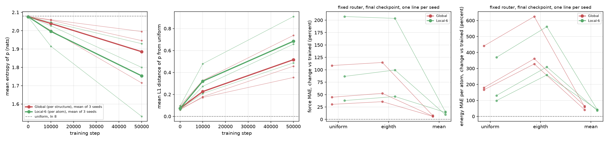

# Router check: why Global and Local-6 reach the same accuracy

Date: 2026-10-18. Jobs 49437535 and 49437538 on Bridges-2. Branch `router-check`. Author: Anshul Kumar (11-785 Team 6).

## 1. Question and hypotheses

The 50,000-step pilots give the same accuracy for Global and Local-6. The final force MAE is 0.0372 eV/A for both. The final energy MAE per atom is 0.0131 eV for Global and 0.0130 eV for Local-6. The Welch p value of the force difference is 0.95. Dense is worse: 0.0388 eV/A and 0.0142 eV.

The two MoLE models have the same parameters. Only the pooling of the composition differs. Global pools over the whole structure. Local-6 pools over the atoms within 6 A of each atom, with a smooth kernel, and mixes the expert outputs per edge. This report asks why the pooling does not change the accuracy.

We test four hypotheses. We do not assume any of them.

- H1. The router is near uniform. Then each MoLE layer acts as one averaged weight matrix, and the pooling cannot matter.
- H2. The router varies, but the 8 experts are almost identical. Then any mixture gives almost the same matrix.
- H3. The gain over Dense comes from the larger parameter bank or from a change of the optimisation, not from specialisation.
- H4. The router specialises, and Global and Local-6 find equivalent mixtures.

## 2. Method

### 2.1 Notation

The router computes logits z from the composition, charge, spin and dataset embeddings. fairchem then computes alpha = softmax(z) + 0.005 (`_softmax` in `fairchem/core/models/uma/nn/mole.py`). So alpha always sums to 1.04. We call p = alpha - 0.005 the router output. p is a distribution over the K = 8 experts. A MoLE layer uses the matrix W(alpha) = sum_k alpha_k W_k, where W_k is the weight slice of expert k.

One router feeds all 24 MoLE layers. The code holds one `MOLEGlobals` object per model, and every MoLE layer reads the same coefficients. So the router statistics are the same for every layer. We report them once.

### 2.2 Measurements

(a) Router statistics. For each routed unit we compute four numbers: the entropy of p (in nats; uniform is ln 8 = 2.07944), the max of p, the L1 distance from uniform, and KL(p || uniform). A unit is a structure for Global and an atom for Local-6. We also compute the standard deviation of each p_k across units. For Local-6 we also compute the spread inside a structure: the standard deviation of p_k over the atoms of one structure, averaged over k and over structures. We do this at step 0, step 10,000 and the final step (50,000) of all six runs.

(b) Expert statistics. For each MoLE layer and checkpoint we compute the pairwise cosine of the 8 flattened expert slices. We compute the spread, sqrt(mean_k |W_k - W_mean|^2) / |W_mean|. Against step 0 of the same run, we compute the same cosine and spread for the training updates U_k = W_k(step) - W_k(0). We also compute the ratio |W - W_mean| / |W(0) - W_mean(0)|, summed over the 8 experts. This ratio tells if the experts moved apart or together during training.

(c) Ablation. We evaluate the final checkpoint four times on the same structures. Each time the router output is a different vector:

- `trained`: the router of the model.
- `uniform`: alpha = 0.13 for every expert. This is the softmax of equal logits plus 0.005, so alpha still sums to 1.04.
- `eighth`: alpha = 0.125 for every expert, sum 1.00. This is the literal value of the request.
- `mean`: alpha = the mean of the trained alpha over all units of the validation set. This is one fixed vector.

`uniform` and `eighth` replace the whole router. `mean` keeps the constant part of the router and removes only the part that depends on the structure or atom. The same vector applies to every structure in Global and to every atom in Local-6.

### 2.3 Implementation

`scripts/router_check.py` replaces the router output through the coefficient norm of the backbone (`fixed_alpha`). It changes no model code. A router-only pass (`route`) repeats the start of `eSCNMDBackbone.forward` and stops before the message passing. The script asserts that `route` gives the same coefficients as the full forward pass on every validation batch (largest difference below 1e-5). It passed for all six runs.

`tests/test_router_check.py` adds four tests:

- A uniform router gives the same energy and forces as the trained router on a copy whose experts all hold 0.13 x sum_k W_k / 1.04. This holds for Global and for Local-6 to 1e-10 in float64.
- `route` equals the coefficients of a forward pass, for Global and for Local-6.
- The router statistics are correct for a uniform p and a one-hot p.
- The expert statistics are correct for identical experts and for identical updates.

We ran the whole test suite with `python -m unittest discover -s tests` in the `IDLF26-mlip` environment on Windows CPU. 114 tests passed: the 110 old tests and the 4 new ones. pytest is not installed in that environment, so we used unittest.

### 2.4 Inference settings

We load each `inference_ckpt.pt` with `load_predict_unit` (EMA weights). The settings follow the training configs: float32, Euler-angle Wigner matrices (`use_quaternion_wigner` left as in the checkpoint), the `general` backend and no stress task. The graph is built on the GPU with the 6 A cutoff and 300 neighbours, which never truncates. Batches hold at most 450 atoms, as in validation. The energy error uses float64 targets and float64 element references.

## 3. Setup

| Item | Value |
|---|---|
| Runs | `pilot_global_s{0,1,2}` (jobs 49041939, 49041940, 49041929), `pilot_local6_s{0,1,2}` (49041936, 49041974, 49041927) |
| Checkpoints | step_0, step_10000, final (labelled 50,000) |
| Data | all 5,000 rows of `manifests/pilot_val_5k.txt`, 510,453 atoms, OMol25 `val` on Ocean |
| Code on Bridges-2 | `/ocean/projects/che260063p/shared/repo_router/AI4Science-MLIPs` (synced from this branch, 163 files identical by SHA-256) |
| Job 49437535 | `slurm/router_check_global.job`, array 0 to 2, `v100-32`, GPU-shared, account `che260063p`, limit 1 h |
| Job 49437538 | `slurm/router_check_local6.job`, array 3 to 5, `l40s-48`, GPU-shared, account `che260063p`, limit 1.5 h |
| Elapsed (sacct) | Global 22:57, 25:01, 24:59; Local-6 43:27, 45:28, 45:28 |
| State | all six tasks COMPLETED, exit 0, no resubmission |
| Time per evaluation pass | Global 242 to 254 s on a V100; Local-6 491 to 520 s on an L40S |
| Peak GPU memory (allocated) | 7.37 GiB (Global), 7.35 GiB (Local-6) |
| Service units | about 3.5 SU: 1.22 V100 GPU-hours plus 2.24 L40S GPU-hours, at 1 SU per GPU-hour. This is our calculation from `sacct`. `job_info` did not list the jobs yet. |
| Outputs on Bridges-2 | `/ocean/projects/che260063p/shared/runs/router_check_49437535/` and `.../router_check_49437538/` |

Before the jobs, we tested the script on the laptop GPU (RTX 5070 Ti) with the first 20 rows of the list (all in shard `data0000`) and the seed 0 checkpoints. The test ran all four conditions for Global and Local-6.

Reproduction check. The `trained` pass reproduces the full-precision final validation numbers of the pilots (from the offline W&B files, `notes/pilotResults50k.md`). The force MAE is equal to 9 significant digits for all six runs, for example 0.037028264 eV/A for Global seed 0. The energy MAE per atom differs by at most 1.1e-6 eV (Global seed 0: 0.013106568 here, 0.013105457 in W&B).

## 4. Results

### 4.1 Router statistics (mean over units)

| Model | Seed | Step | Entropy | Max p | L1 to uniform | KL | Std of p_k across units |
|---|---:|---:|---:|---:|---:|---:|---:|
| Global | 0 | 0 | 2.07387 | 0.15120 | 0.09490 | 0.00558 | 0.00044 |
| Global | 0 | 10000 | 2.00110 | 0.23672 | 0.32752 | 0.07835 | 0.01565 |
| Global | 0 | 50000 | 1.71496 | 0.37887 | 0.73812 | 0.36448 | 0.02657 |
| Global | 1 | 0 | 2.07675 | 0.14027 | 0.06699 | 0.00269 | 0.00047 |
| Global | 1 | 10000 | 2.05958 | 0.16853 | 0.17184 | 0.01986 | 0.01458 |
| Global | 1 | 50000 | 1.99536 | 0.22620 | 0.35445 | 0.08409 | 0.02367 |
| Global | 2 | 0 | 2.07710 | 0.13680 | 0.05953 | 0.00234 | 0.00042 |
| Global | 2 | 10000 | 2.05674 | 0.17806 | 0.17918 | 0.02270 | 0.01353 |
| Global | 2 | 50000 | 1.94561 | 0.25345 | 0.45734 | 0.13383 | 0.02468 |
| Local-6 | 0 | 0 | 2.07387 | 0.15118 | 0.09478 | 0.00557 | 0.00051 |
| Local-6 | 0 | 10000 | 1.91501 | 0.28852 | 0.47894 | 0.16443 | 0.02305 |
| Local-6 | 0 | 50000 | 1.53236 | 0.43985 | 0.90951 | 0.54708 | 0.03038 |
| Local-6 | 1 | 0 | 2.07676 | 0.14023 | 0.06689 | 0.00268 | 0.00055 |
| Local-6 | 1 | 10000 | 2.04627 | 0.19057 | 0.20859 | 0.03317 | 0.02002 |
| Local-6 | 1 | 50000 | 1.92899 | 0.26144 | 0.48761 | 0.15045 | 0.03066 |
| Local-6 | 2 | 0 | 2.07710 | 0.13679 | 0.05954 | 0.00234 | 0.00049 |
| Local-6 | 2 | 10000 | 2.02696 | 0.20047 | 0.27364 | 0.05249 | 0.01680 |
| Local-6 | 2 | 50000 | 1.79954 | 0.30816 | 0.65741 | 0.27990 | 0.03076 |

Local-6 at step 50,000, seeds 0, 1, 2: the standard deviation of the structure mean of p_k across structures is 0.02679, 0.02674 and 0.02722. The spread inside one structure is 0.01618, 0.01433 and 0.01500. The ratio of the two is 0.604, 0.536 and 0.551. The mean L1 distance of an atom from its structure mean is 0.09874, 0.09008 and 0.09204.

The mean p of the final Global seed 0 router is 0.378 on expert 0, 0.209 on expert 3, 0.138 on expert 7 and 0.107 on expert 4. The other four experts get 0.041 to 0.044 each.

### 4.2 Global against Local-6 of the same seed

Global and Local-6 with the same seed start from the same weights. Source: `results/router_check_global_vs_local6.csv`.

| Seed | Step | L1 between mean p vectors | Cosine of mean p vectors | Mean correlation across structures | Top 3 experts, Global | Top 3, Local-6 |
|---:|---:|---:|---:|---:|---|---|
| 0 | 0 | 0.00046 | 1.000 | 0.993 | 0 3 4 | 0 3 4 |
| 0 | 50000 | 0.18138 | 0.993 | 0.605 | 0 3 7 | 0 3 7 |
| 1 | 0 | 0.00063 | 1.000 | 0.994 | 7 4 2 | 7 4 2 |
| 1 | 50000 | 0.38603 | 0.894 | 0.489 | 4 0 7 | 0 7 5 |
| 2 | 0 | 0.00028 | 1.000 | 0.992 | 4 5 6 | 4 5 6 |
| 2 | 50000 | 0.26213 | 0.975 | 0.755 | 5 6 2 | 5 4 6 |

For Local-6, "per structure" means the mean p over the atoms of the structure.

### 4.3 Expert statistics (mean over the 24 MoLE layers)

| Model | Seed | Step | Cosine between experts | Spread | Cosine between updates | Min cosine between updates | Spread of updates | Expert deviation / deviation at step 0 |
|---|---:|---:|---:|---:|---:|---:|---:|---:|
| Global | 0 | 0 | 0.0000 | 2.646 | | | | |
| Global | 0 | 10000 | 0.2071 | 1.566 | 0.9896 | 0.9648 | 0.0989 | 0.9998 |
| Global | 0 | 50000 | 0.3858 | 1.111 | 0.9701 | 0.9262 | 0.1659 | 1.0057 |
| Global | 1 | 50000 | 0.3904 | 1.101 | 0.9675 | 0.8690 | 0.1727 | 1.0066 |
| Global | 2 | 50000 | 0.3921 | 1.098 | 0.9775 | 0.9365 | 0.1425 | 1.0029 |
| Local-6 | 0 | 50000 | 0.3736 | 1.135 | 0.9483 | 0.8763 | 0.2217 | 1.0138 |
| Local-6 | 1 | 50000 | 0.3853 | 1.111 | 0.9537 | 0.8468 | 0.2066 | 1.0115 |
| Local-6 | 2 | 50000 | 0.3834 | 1.115 | 0.9605 | 0.9131 | 0.1907 | 1.0088 |

Per layer, at step 50,000: the cosine between experts is 0.19 to 0.65. The mean cosine between updates is 0.953 to 0.986 (Global) and 0.928 to 0.977 (Local-6). The deviation ratio is 0.997 to 1.038. The mean norm of an update is 0.81 to 0.82 times the mean norm of an expert at step 0. The step 0 rows of all six runs have a cosine near 0 and a spread of 2.644 to 2.646.

### 4.4 Ablation on all 5,000 structures, final checkpoint

| Model | Seed | Energy MAE per atom (eV): trained, uniform, eighth, mean | Force MAE (eV/A): trained, uniform, eighth, mean |
|---|---:|---|---|
| Global | 0 | 0.013107, 0.070838, 0.095003, 0.020825 | 0.037028, 0.077238, 0.079509, 0.039879 |
| Global | 1 | 0.013542, 0.036033, 0.057939, 0.019105 | 0.037456, 0.048811, 0.050850, 0.039745 |
| Global | 2 | 0.012617, 0.035250, 0.058115, 0.020691 | 0.037124, 0.053719, 0.056640, 0.039530 |
| Local-6 | 0 | 0.013100, 0.061466, 0.086618, 0.018635 | 0.037045, 0.113848, 0.112457, 0.042751 |
| Local-6 | 1 | 0.013191, 0.026194, 0.047344, 0.018810 | 0.037433, 0.051629, 0.054701, 0.042730 |
| Local-6 | 2 | 0.012757, 0.029394, 0.052227, 0.017324 | 0.037094, 0.069253, 0.073998, 0.040658 |

Change against `trained`, mean over the 3 seeds, with a paired t test over seeds (n = 3, 2 degrees of freedom). Source: `results/router_check_tests.csv`.

| Condition | Model | Energy change | Energy p | Force change | Force p |
|---|---|---:|---:|---:|---:|
| uniform | Global | +0.03428 eV (+262 percent) | 0.100 | +0.02272 eV/A (+61.2 percent) | 0.125 |
| uniform | Local-6 | +0.02600 eV (+199 percent) | 0.147 | +0.04105 eV/A (+110.6 percent) | 0.158 |
| eighth | Global | +0.05726 eV (+438 percent) | 0.043 | +0.02513 eV/A (+67.7 percent) | 0.105 |
| eighth | Local-6 | +0.04905 eV (+376 percent) | 0.058 | +0.04319 eV/A (+116.4 percent) | 0.127 |
| mean | Global | +0.00712 eV (+54.7 percent) | 0.012 | +0.00252 eV/A (+6.8 percent) | 0.0046 |
| mean | Local-6 | +0.00524 eV (+40.2 percent) | 0.0041 | +0.00486 eV/A (+13.1 percent) | 0.018 |

Per seed, the uniform router raises the energy error by 166 to 441 percent (Global) and 99 to 369 percent (Local-6). It raises the force error by 30 to 109 percent (Global) and 38 to 207 percent (Local-6). All 36 ablated values (6 runs, 3 fixed routers, 2 metrics) are larger than the trained value of the same run.

Welch t test of Global against Local-6 on the change: uniform, energy p 0.64, force p 0.44; mean, energy p 0.12, force p 0.062.

The `mean` change divided by the `uniform` change, per run, is 0.11 to 0.43 for energy and 0.07 to 0.37 for force. For seed 0, the uniform router makes the energy error worse for 95.0 percent (Global) and 93.3 percent (Local-6) of the structures. The mean router makes it worse for 70.6 and 65.6 percent.

### 4.5 Figure



`results/figures/router_check.png`. Panel 1: mean entropy of p along training. Panel 2: mean L1 distance from uniform. Panels 3 and 4: change of the force MAE and of the energy MAE per atom under the three fixed routers. Thin lines are seeds. Thick lines are the mean of the 3 seeds.

## 5. Analysis

### 5.1 Measured facts

- At step 0 the router is near uniform: entropy 2.0739 to 2.0771 against 2.0794.
- At step 50,000 the entropy is 1.53 to 2.00, and the mean max p is 0.23 to 0.44.
- Local-6 moves further from uniform than Global for every seed (L1 0.91, 0.49, 0.66 against 0.74, 0.35, 0.46).
- The router output varies between units: the standard deviation of p_k is 0.024 to 0.027 (Global) and 0.030 to 0.031 (Local-6), against 0.0004 to 0.0006 at step 0.
- Inside a Local-6 structure, p varies about 0.54 to 0.60 times as much as between structures.
- At step 50,000 the experts are not identical: the mean cosine between experts is 0.37 to 0.39.
- The training updates of the 8 experts are almost parallel: mean cosine 0.95 to 0.98.
- The deviation of the experts from their mean is 1.003 to 1.014 times its value at step 0.
- The uniform router raises both errors in all six runs.
- The mean router raises both errors in all six runs, with p below 0.02 for all four seed-level tests.
- For the same seed, the mean p vectors of Global and Local-6 have a cosine of 0.89 to 0.99 at step 50,000.
- Global and Local-6 do not differ in the change under any fixed router at p below 0.05.

### 5.2 Interpretations

- H1 is rejected. The router is far from uniform, and replacing it with a uniform vector costs a lot of accuracy.
- H2 is rejected in its stated form. The experts differ, with a cosine near 0.38, so the mixture depends on alpha.
- The experts differ mainly by their random initial values. The learned part of each expert is mostly shared, because the updates are almost parallel and the deviation from the mean did not grow.
- So most of what training adds to a MoLE layer is one shared matrix. The router then selects a weighted sum of the 8 fixed random initial matrices on top of it.
- The router does work. Most of its effect is a constant, seed-specific mixture: the `mean` router keeps 63 to 93 percent of the force damage away, compared with the uniform router.
- The part of the router that depends on the composition is real but smaller. It is worth 6 to 15 percent of the force error and 36 to 64 percent of the energy error.
- H4 is supported in a weak form. Global and Local-6 of the same seed reach similar mixtures, and the same initial weights mostly decide which experts win.
- "Specialisation" here does not mean that experts learn different functions. It means that the router learns to weight fixed random parts differently for different compositions.
- H3 is neither confirmed nor rejected. The data fit a mechanism where the bank changes the effective weights and adds random components, but we did not retrain anything.
- This explains the equal accuracy as follows. Both models get the large constant part in the same way. Only the composition-dependent part can see the pooling. That part is small, and on these molecules the local composition varies inside a structure only about half as much as between structures. So the two poolings give the model nearly the same signal.

### 5.3 Effective weight scale (reasoning, not a measurement of Dense)

At step 0 the uniform mixture 0.13 x sum_k W_k has 0.368 times the norm of one expert (measured, `uniform_eff_over_expert`). This equals 0.13 x sqrt(8) = 0.368 for 8 independent experts. torch `nn.Linear` and fairchem `init_linear` both draw from U(-k, k) with k = 1/sqrt(fan_in). So a MoLE layer starts with a smaller effective matrix than the Dense layer. At step 50,000 the ratio is 0.69 to 0.71. This is one candidate mechanism for H3. We did not test it.

## 6. The strongest counterargument

The ablation is an inference-time test. It measures how much a trained network depends on its own alpha. It does not measure how much routing helps learning. The network co-adapts to its alpha during training. Any change of alpha then moves W(alpha) away from what the other layers expect. The change moves mainly the random initial component, which is large (the update is only 0.81 times the initial norm). So the large uniform damage can come from this mismatch alone. A model trained from the start with a fixed, constant alpha might reach the same accuracy. The same argument weakens the `mean` result: it also breaks co-adaptation, only less. If this is true, H3 is the right answer and the router adds nothing that a fixed mixture could not. Our data cannot separate the two cases. Only a training run with a frozen router can.

## 7. Caveats

- Three seeds per model. The paired t tests have 2 degrees of freedom. The uniform changes are large but vary a lot between seeds, so their p values are 0.10 to 0.16.
- One validation set of 5,000 structures. These structures are larger than the training structures on average (102 against 55 atoms).
- Short training. 50,000 steps are about 1/760 of the official eSEN run. The router moved further from uniform at every checkpoint, so a longer run may change the picture.
- Checkpoints. We used step 0, step 10,000 and the final step only. The step 0 checkpoint exists for every run and holds the initial weights; at step 0 the EMA copy equals them (reasoning from how the EMA starts, as in `docs/size-consistency-training.md`).
- EMA weights. All numbers are for the EMA weights, as in validation.
- Different GPUs. Global ran on V100s and Local-6 on L40Ss. The reproduction check shows the same numbers as the training validation, so the GPU type did not change the metrics at the printed precision.
- The `mean` vector is the mean over units: structures for Global, atoms for Local-6.
- The Global against Local-6 comparison uses the structure mean for Local-6, which hides the per-atom part.

## 8. What to do next

1. Train with a frozen router. Use one constant alpha (the trained mean, or uniform) for the whole run, one seed first. This is the direct test of the counterargument and of H3.
2. Train Dense with the SO(2) linear weights scaled by 0.368 at initialisation. This tests the init-scale part of H3.
3. Swap the routers at inference: load a Global checkpoint into the Local-6 backbone and the reverse. The state dicts are identical. This tests if each model already works with the other pooling.
4. Repeat the expert-update measurement every 5,000 steps to see when the updates stop being parallel.
5. Repeat all of this on the full-length runs when they exist.

## 9. Files and commands

- `scripts/router_check.py`: the measurement (`run`) and the merge, tests and figure (`analyze`).
- `tests/test_router_check.py`: four tests.
- `slurm/router_check.sh`, `slurm/router_check_global.job`, `slurm/router_check_local6.job`: the jobs.
- `results/router_check_router.csv` (18 rows), `results/router_check_experts.csv` (432 rows), `results/router_check_ablation.csv` (24 rows), `results/router_check_tests.csv` (18 rows), `results/router_check_global_vs_local6.csv` (9 rows), `results/figures/router_check.png`.
- Per-structure router outputs and errors: `router_check_<variant>_s<seed>_per_structure.npz` in the two run folders on Bridges-2 (not in git).

```bash
# on Bridges-2, after syncing this branch to shared/repo_router
cd /ocean/projects/che260063p/shared/slurm
sbatch /ocean/projects/che260063p/shared/repo_router/AI4Science-MLIPs/slurm/router_check_global.job
sbatch /ocean/projects/che260063p/shared/repo_router/AI4Science-MLIPs/slurm/router_check_local6.job
# on any machine, with the per-run CSV and npz files in DIR
python scripts/router_check.py analyze --in-dir DIR
```
