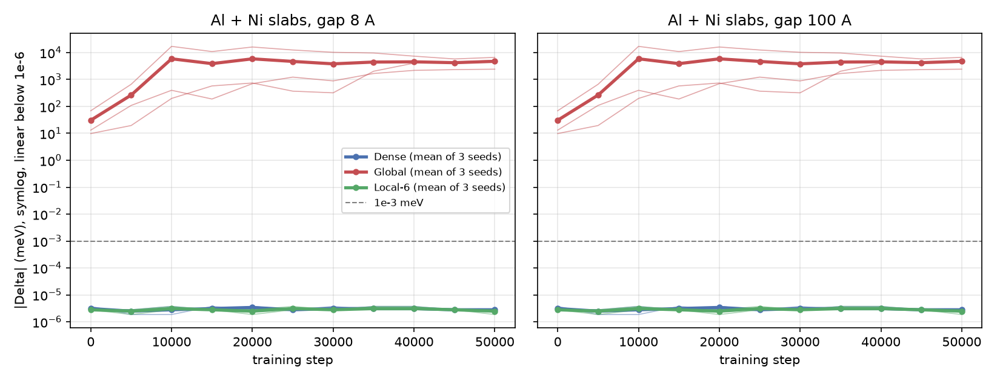

# Size consistency along training: Dense, Global and Local-6 pilots

Date: 2026-10-15. Job 49266770 on Bridges-2. Author: Anshul Kumar (11-785 Team 6).

## 1. Question and why it matters

We trained three models for the pilot: Dense, Global and Local-6. Each model has three seeds. Each run has 50,000 steps. The pilot job measured size consistency only on the final checkpoint. That measurement showed a clear split. Dense and Local-6 gave zero. Global gave 2.4 to 6.6 eV.

This report asks two questions.

1. How does the size-consistency error of Global grow along training, checkpoint by checkpoint?
2. Do Dense and Local-6 stay at zero at every checkpoint, or only at the end?

These questions matter for three reasons.

- The project claims that the Global router breaks size consistency and that a local router keeps it. A claim from the final checkpoint alone can hide a transient. A model could be size consistent at the end by chance and not along the way. A model could also be broken at the start and repair itself. Only a measurement along training can rule these out.
- The growth curve tells us where the error comes from. An error that is present at initialization comes from the architecture. An error that appears only late comes from what the model learns. The two cases need different fixes.
- The midterm report needs a figure of this test. The final-checkpoint table is not enough to show the mechanism.

## 2. What Delta is

Delta is the size-consistency error of a model for two fragments that do not interact. Let A be an Al slab and B be a Ni slab. Let g be the empty gap between them, in angstrom (A). Let E(X) be the energy the model predicts for structure X, in eV. Then

```text
Delta(g) = [ E(A+B at gap g) - E(A) - E(B) ] * 1000      (meV)
```

- E(A+B at gap g) is the energy of the two slabs in one periodic cell, with gap g on both sides of each slab.
- E(A) and E(B) are the energies of each slab alone, in a periodic cell with 20 A of empty space above it.
- The factor 1000 converts eV to meV.

A size-consistent model gives Delta = 0 for any gap larger than its interaction range. The exact physics also gives zero, because two neutral slabs 8 A apart do not bond. The real interaction at 8 A is small and at 100 A it is negligible. A model with a finite cutoff and no global term gives zero at both gaps. A model with a global term can give a non-zero Delta that does not depend on the gap.

The code that computes Delta is the same code that the final-checkpoint stage of `slurm/pilot.sh` uses (`audit/check_checkpoint.py`). The new script calls the same functions: `geometry.ideal_slab`, `geometry.isolated`, `geometry.stacked`, `geometry.assert_disconnected` and `models.load`. We did not rewrite any of them.

## 3. Setup

### 3.1 Models

| Variant | Backbone | Router | Parameters (total) | Training GPU |
|---|---|---|---:|---|
| Dense | `eSCNMDBackbone`, 4 layers | none | 5,981,057 | V100-32 |
| Global | `eSCNMDMoeBackbone`, 4 layers, 8 experts | mean element embedding over the whole structure | 37,652,265 | V100-32 |
| Local-6 | `eSCNMDLocalMoeBackbone`, 4 layers, 8 experts | mean element embedding of the neighbours within 6 A, per atom | 37,652,265 | H100-80 |

The parameter counts come from `docs/TRAINING.md`. All three use a 6.0 A graph cutoff, `max_neighbors` 300 and `num_distance_basis` 64. Global and Local-6 have the same parameters and differ only in the router.

### 3.2 Training runs

- Nine runs: three variants, seeds 0, 1 and 2.
- 50,000 optimizer steps, 450 atoms per batch, the fixed lists of 200,000 training rows and 5,000 validation rows of OMol25.
- EMA of the weights with decay 0.999. The inference loader of fairchem 2.21.0 loads the EMA weights (`load_inference_model(..., use_ema=True)` in `fairchem/core/units/mlip_unit/predict.py`, line 152). So every Delta in this report is for the EMA weights, as in the pilot stage.
- The runs are in `/ocean/projects/che260063p/shared/runs/pilot_<variant>_s<seed>_<jobid>/`. The run folders are `pilot_dense_s0_49041937`, `pilot_dense_s1_49041938`, `pilot_dense_s2_49041928`, `pilot_global_s0_49041939`, `pilot_global_s1_49041940`, `pilot_global_s2_49041929`, `pilot_local6_s0_49041936`, `pilot_local6_s1_49041974` and `pilot_local6_s2_49041927`. The script ignores the `aborted_pilot_*`, `pilottest_*` and older 30-step `pilot_<variant>_<jobid>` folders, because its name pattern requires `_s<seed>_`.

### 3.3 Checkpoints

The pilot job set `max_saved_checkpoints` to steps/ckpt_every + 2 = 12. So it kept every checkpoint. Each run has 11 inference checkpoints: `step_0`, `step_5000` to `step_45000` in steps of 5,000, and `final`. We listed them on Bridges-2 and every run has all 11 files (`inference_ckpt.pt`).

- A step 0 checkpoint exists. fairchem writes it before the first optimizer step. So step 0 is the initialized model and we did not need to build a fresh model.
- A `step_N` checkpoint is written before step N runs, so it holds the weights after N optimizer steps.
- No `step_50000` folder exists. The `final` checkpoint is written after the last step (the log shows the last train step as 49999). We label it as step 50,000.
- In total: 9 runs x 11 checkpoints = 99 checkpoints, and 99 x 2 gaps = 198 values of Delta.

### 3.4 Geometry

- Slabs: fcc(111), 4 x 4 in plane, 8 layers, 128 atoms each (`audit/geometry.py`).
- Lattice constants: Al 4.05 A and Ni 3.52 A (the ASE reference values).
- Both slabs use one shared in-plane cell, the mean of the two nearest-neighbour spacings. This strains Al by -6.54 percent and Ni by +7.53 percent in plane. The geometry self-test asserts these two strains.
- Ideal positions only. No rattle. This is run 0 of the audit, the same geometry the pilot stage used.
- Gaps: 8 A and 100 A. The pair has 256 atoms.
- Before each pair energy, `assert_disconnected` checks that no atom of one slab is within the cutoff plus 1 A (7 A) of any atom of the other slab, periodic images included. The check passed for every checkpoint.
- Charge 0 and spin 1 for every structure, the OMol task default in `audit/models.py`. Task `omol`.

### 3.5 Precision and hardware

- Inference in float64 (`InferenceSettings(base_precision_dtype=torch.float64)`), as in the pilot stage. `merge_mole` is False (the fairchem default), so the router runs on every structure.
- GPU: one Tesla V100-SXM2-32GB on node v010, partition GPU-shared, account `che260063p`.
- A local test on the laptop GPU, with the three seed 0 final checkpoints, measured a peak of 2.53 GiB of allocated GPU memory. So a V100 with 32 GB was more than enough, also for Local-6.

### 3.6 Job, run time and cost

| Item | Value |
|---|---|
| Job id | 49266770 |
| Job file | `slurm/size_consistency_training.job` (calls `slurm/size_consistency_training.sh`) |
| Submitted | 2026-10-15 19:56 |
| Start and end | 2026-10-15 19:58:16 to 20:14:11 |
| Elapsed | 15 min 55 s (`sacct`) |
| State | COMPLETED, exit 0 |
| Service units | about 0.27 SU (15.9 min x 1 SU per V100 GPU-hour). `job_info` did not list the job yet when we read it, so this is our own calculation from `sacct`, not the charge record. |
| Time limit | 2 h |
| Resubmissions | none |

The job ran the script once over all 99 checkpoints. The script wrote its results to `/ocean/projects/che260063p/shared/runs/size_consistency_training_49266770/work/results/`, outside the repository copy, so a later repository sync cannot overwrite them. We then downloaded the three CSV files into `results/`.

### 3.7 Self-check

The script ends with two asserts.

1. Every Dense and Local-6 value has |Delta| below 1e-3 meV.
2. The final-checkpoint Delta of each run equals the Delta that the pilot job printed in its `summary.txt`.

Both asserts passed in the job. The second assert is a validation by rerun: the new code reproduces -5141.97, -6626.33 and +2417.22 meV for Global and the floor values for Dense and Local-6. We also ran the 110 existing CPU tests in `tests/` on Windows. All 110 passed.

## 4. Results

### 4.1 Delta for every run, step and gap (meV)

Columns s0, s1 and s2 are the seeds. Every value is from `results/size_consistency_training.csv`, rounded for the table. The CSV holds the full float64 values.

#### Dense

| Step | s0, 8 A | s1, 8 A | s2, 8 A | s0, 100 A | s1, 100 A | s2, 100 A |
|---:|---:|---:|---:|---:|---:|---:|
| 0 | 2.794e-06 | 2.794e-06 | 3.725e-06 | 2.794e-06 | 2.794e-06 | 3.725e-06 |
| 5000 | 2.794e-06 | 2.794e-06 | 1.863e-06 | 2.794e-06 | 2.794e-06 | 1.863e-06 |
| 10000 | 3.725e-06 | 2.794e-06 | 1.863e-06 | 3.725e-06 | 2.794e-06 | 1.863e-06 |
| 15000 | 2.794e-06 | 2.794e-06 | 3.725e-06 | 2.794e-06 | 2.794e-06 | 3.725e-06 |
| 20000 | 3.725e-06 | 3.725e-06 | 2.794e-06 | 3.725e-06 | 3.725e-06 | 2.794e-06 |
| 25000 | 2.794e-06 | 2.794e-06 | 2.794e-06 | 2.794e-06 | 2.794e-06 | 2.794e-06 |
| 30000 | 3.725e-06 | 2.794e-06 | 2.794e-06 | 3.725e-06 | 2.794e-06 | 2.794e-06 |
| 35000 | 2.794e-06 | 2.794e-06 | 3.725e-06 | 2.794e-06 | 2.794e-06 | 3.725e-06 |
| 40000 | 2.794e-06 | 2.794e-06 | 3.725e-06 | 2.794e-06 | 2.794e-06 | 3.725e-06 |
| 45000 | 2.794e-06 | 2.794e-06 | 2.794e-06 | 2.794e-06 | 2.794e-06 | 2.794e-06 |
| 50000 | 2.794e-06 | 2.794e-06 | 2.794e-06 | 2.794e-06 | 2.794e-06 | 2.794e-06 |

#### Global

| Step | s0, 8 A | s1, 8 A | s2, 8 A | s0, 100 A | s1, 100 A | s2, 100 A |
|---:|---:|---:|---:|---:|---:|---:|
| 0 | -9.810 | 68.962 | -13.156 | -9.810 | 68.962 | -13.156 |
| 5000 | -19.514 | 663.144 | 108.784 | -19.514 | 663.144 | 108.784 |
| 10000 | 197.876 | -16988.939 | 397.134 | 197.876 | -16988.939 | 397.134 |
| 15000 | -576.752 | -10883.803 | -188.374 | -576.752 | -10883.803 | -188.374 |
| 20000 | 740.434 | -16093.841 | 699.609 | 740.434 | -16093.841 | 699.609 |
| 25000 | 368.715 | -12462.188 | 1225.593 | 368.715 | -12462.188 | 1225.593 |
| 30000 | -319.682 | -10229.322 | 886.663 | -319.682 | -10229.322 | 886.663 |
| 35000 | -2024.930 | -9634.409 | 1668.090 | -2024.930 | -9634.409 | 1668.090 |
| 40000 | -4049.474 | -7356.763 | 2181.725 | -4049.474 | -7356.763 | 2181.725 |
| 45000 | -4497.608 | -5792.299 | 2325.970 | -4497.608 | -5792.299 | 2325.970 |
| 50000 | -5141.974 | -6626.333 | 2417.224 | -5141.974 | -6626.333 | 2417.224 |

#### Local-6

| Step | s0, 8 A | s1, 8 A | s2, 8 A | s0, 100 A | s1, 100 A | s2, 100 A |
|---:|---:|---:|---:|---:|---:|---:|
| 0 | 2.794e-06 | 2.794e-06 | 2.794e-06 | 2.794e-06 | 2.794e-06 | 2.794e-06 |
| 5000 | 1.863e-06 | 2.794e-06 | 2.794e-06 | 1.863e-06 | 2.794e-06 | 2.794e-06 |
| 10000 | 2.794e-06 | 3.725e-06 | 2.794e-06 | 2.794e-06 | 3.725e-06 | 2.794e-06 |
| 15000 | 2.794e-06 | 2.794e-06 | 2.794e-06 | 2.794e-06 | 2.794e-06 | 2.794e-06 |
| 20000 | 2.794e-06 | 2.794e-06 | 1.863e-06 | 2.794e-06 | 2.794e-06 | 1.863e-06 |
| 25000 | 3.725e-06 | 2.794e-06 | 2.794e-06 | 3.725e-06 | 2.794e-06 | 2.794e-06 |
| 30000 | 2.794e-06 | 2.794e-06 | 2.794e-06 | 2.794e-06 | 2.794e-06 | 2.794e-06 |
| 35000 | 2.794e-06 | 3.725e-06 | 2.794e-06 | 2.794e-06 | 3.725e-06 | 2.794e-06 |
| 40000 | 2.794e-06 | 3.725e-06 | 2.794e-06 | 2.794e-06 | 3.725e-06 | 2.794e-06 |
| 45000 | 2.794e-06 | 2.794e-06 | 2.794e-06 | 2.794e-06 | 2.794e-06 | 2.794e-06 |
| 50000 | 1.863e-06 | 2.794e-06 | 2.794e-06 | 1.863e-06 | 2.794e-06 | 2.794e-06 |

### 4.2 Mean and range over the three seeds (meV)

The 8 A and 100 A values are identical in every row (section 5.2), so this table shows one set of columns for both gaps. "Mean |Delta|" is the mean of the absolute values.

| Step | Dense mean | Dense min to max | Global mean | Global min to max | Global mean abs | Local-6 mean | Local-6 min to max |
|---:|---:|---|---:|---|---:|---:|---|
| 0 | 3.104e-06 | 2.794e-06 to 3.725e-06 | 15.332 | -13.156 to 68.962 | 30.643 | 2.794e-06 | 2.794e-06 to 2.794e-06 |
| 5000 | 2.484e-06 | 1.863e-06 to 2.794e-06 | 250.805 | -19.514 to 663.144 | 263.814 | 2.484e-06 | 1.863e-06 to 2.794e-06 |
| 10000 | 2.794e-06 | 1.863e-06 to 3.725e-06 | -5464.643 | -16988.939 to 397.134 | 5861.317 | 3.104e-06 | 2.794e-06 to 3.725e-06 |
| 15000 | 3.104e-06 | 2.794e-06 to 3.725e-06 | -3882.976 | -10883.803 to -188.374 | 3882.976 | 2.794e-06 | 2.794e-06 to 2.794e-06 |
| 20000 | 3.415e-06 | 2.794e-06 to 3.725e-06 | -4884.599 | -16093.841 to 740.434 | 5844.628 | 2.484e-06 | 1.863e-06 to 2.794e-06 |
| 25000 | 2.794e-06 | 2.794e-06 to 2.794e-06 | -3622.627 | -12462.188 to 1225.593 | 4685.499 | 3.104e-06 | 2.794e-06 to 3.725e-06 |
| 30000 | 3.104e-06 | 2.794e-06 to 3.725e-06 | -3220.780 | -10229.322 to 886.663 | 3811.889 | 2.794e-06 | 2.794e-06 to 2.794e-06 |
| 35000 | 3.104e-06 | 2.794e-06 to 3.725e-06 | -3330.416 | -9634.409 to 1668.090 | 4442.476 | 3.104e-06 | 2.794e-06 to 3.725e-06 |
| 40000 | 3.104e-06 | 2.794e-06 to 3.725e-06 | -3074.837 | -7356.763 to 2181.725 | 4529.321 | 3.104e-06 | 2.794e-06 to 3.725e-06 |
| 45000 | 2.794e-06 | 2.794e-06 to 2.794e-06 | -2654.646 | -5792.299 to 2325.970 | 4205.292 | 2.794e-06 | 2.794e-06 to 2.794e-06 |
| 50000 | 2.794e-06 | 2.794e-06 to 2.794e-06 | -3117.028 | -6626.333 to 2417.224 | 4728.510 | 2.484e-06 | 1.863e-06 to 2.794e-06 |

### 4.3 Figure



`results/figures/size_consistency_training.png`. The y axis is |Delta| in meV on a symmetric-log scale, linear below 1e-6 meV. Thin lines are the three seeds. Thick lines with markers are the mean over seeds. The dashed line is 1e-3 meV. The left panel is the 8 A gap and the right panel is the 100 A gap.

### 4.4 Loss at each checkpoint (mean over the three seeds)

The train loss is the mean of the logged train loss over the 500 steps before the checkpoint. The validation loss is the last validation before the checkpoint was saved. Step 0 has neither. The step 50,000 value is from the final validation. Source: `results/size_consistency_training_loss.csv`, parsed from `logs/train.log` of each run.

| Step | Dense train | Dense val | Global train | Global val | Local-6 train | Local-6 val |
|---:|---:|---:|---:|---:|---:|---:|
| 5000 | 0.2666 | 0.1817 | 0.2660 | 0.1864 | 0.2657 | 0.1869 |
| 10000 | 0.2018 | 0.1247 | 0.2003 | 0.1247 | 0.2025 | 0.1249 |
| 15000 | 0.1704 | 0.1034 | 0.1677 | 0.1011 | 0.1677 | 0.1007 |
| 20000 | 0.1484 | 0.0899 | 0.1444 | 0.0870 | 0.1447 | 0.0871 |
| 25000 | 0.1291 | 0.0809 | 0.1261 | 0.0779 | 0.1263 | 0.0778 |
| 30000 | 0.1123 | 0.0741 | 0.1087 | 0.0713 | 0.1085 | 0.0713 |
| 35000 | 0.1037 | 0.0695 | 0.1004 | 0.0667 | 0.1003 | 0.0665 |
| 40000 | 0.0921 | 0.0664 | 0.0887 | 0.0636 | 0.0886 | 0.0635 |
| 45000 | 0.0880 | 0.0648 | 0.0847 | 0.0618 | 0.0846 | 0.0618 |
| 50000 | 0.0849 | 0.0641 | 0.0816 | 0.0611 | 0.0815 | 0.0611 |

### 4.5 Global router output

For Global we recorded the 8 expert mixing weights of the router for the Al slab, the Ni slab and the union at each gap. These are the values in `global_mole_tensors.expert_mixing_coefficients` after each forward pass. They sum to 1.04, not 1: fairchem's softmax norm adds 0.005 to every weight (`_softmax` in `fairchem/core/models/uma/nn/mole.py`; checked on all 132 rows of the CSV). A uniform router would give 0.13 to each expert. The table shows the L1 distance between the Al and Ni weight vectors, and the L1 distance between the union and the midpoint (w_Al + w_Ni)/2. Source: `results/size_consistency_training_router.csv`.

| Step | s0 L1(Al, Ni) | s1 L1(Al, Ni) | s2 L1(Al, Ni) | s0 L1(union, mid) | s1 L1(union, mid) | s2 L1(union, mid) |
|---:|---:|---:|---:|---:|---:|---:|
| 0 | 0.0199 | 0.0221 | 0.0166 | 0.0024 | 0.0021 | 0.0011 |
| 5000 | 0.0339 | 0.1135 | 0.0220 | 0.0030 | 0.0115 | 0.0017 |
| 10000 | 0.0431 | 0.1308 | 0.0272 | 0.0025 | 0.0116 | 0.0020 |
| 15000 | 0.0528 | 0.1042 | 0.0263 | 0.0022 | 0.0121 | 0.0021 |
| 20000 | 0.0792 | 0.0864 | 0.0282 | 0.0021 | 0.0117 | 0.0026 |
| 25000 | 0.0808 | 0.0809 | 0.0346 | 0.0021 | 0.0103 | 0.0026 |
| 30000 | 0.1056 | 0.0743 | 0.0382 | 0.0023 | 0.0096 | 0.0026 |
| 35000 | 0.1288 | 0.0714 | 0.0404 | 0.0028 | 0.0106 | 0.0026 |
| 40000 | 0.1254 | 0.0667 | 0.0418 | 0.0027 | 0.0099 | 0.0028 |
| 45000 | 0.1285 | 0.0674 | 0.0431 | 0.0027 | 0.0096 | 0.0028 |
| 50000 | 0.1305 | 0.0676 | 0.0436 | 0.0027 | 0.0096 | 0.0028 |

The union weights at 8 A and at 100 A are identical at every checkpoint (L1 distance 0). The largest single weight at step 50,000 is 0.231 (s0), 0.158 (s1) and 0.170 (s2) for the union. We did not record the per-atom weights of Local-6.

### 4.6 Energies

The full table of E(A), E(B) and E(A+B) for every checkpoint is in section 10. The absolute energies are near -6.1e6 eV for the pair, -8.44e5 eV for Al and -5.25e6 eV for Ni.

## 5. Analysis

### 5.1 The floor: Dense and Local-6 are zero at every checkpoint

All 132 Dense and Local-6 values lie between 1.863e-06 and 3.725e-06 meV. Only three distinct values occur: 1.862645e-06, 2.793968e-06 and 3.725290e-06 meV. We computed the float64 spacing (one unit in the last place, ulp) of the union energy with `numpy.spacing`. For |E| between 2^22 and 2^23 eV, which holds for every union energy here, one ulp is 2^-30 eV = 9.313e-07 meV. The three values are exactly 2, 3 and 4 ulp. So the Dense and Local-6 values are rounding error of the float64 sums. They are not a model effect. They are 270 to 540 times below the 1e-3 meV scale.

Why a radius graph gives zero. Write the model energy as a sum of per-atom terms, E = sum_i e_i. Each e_i is a function of the features of atom i after the last of the 4 message-passing layers. Layer l + 1 updates atom i from its own features and the features of its neighbours j in N(i), with N(i) = { j : |r_ij| < 6 A }, periodic images included. Now compare atom i of slab A in the union with the same atom in slab A alone.

- The in-plane cell is the same, so the in-plane images are the same.
- In the isolated cell, the next image along z is more than 20 A away. In the union cell, slab B is 8 A or 100 A away on both sides. Both distances exceed 6 A.
- So N(i) and every vector r_ij are the same in both cells.
- The charge and spin inputs are the same (0 and 1) in both.
- By induction over the layers, every feature of atom i is the same, so e_i is the same.

Summing over atoms gives E(A+B) = E(A) + E(B) in exact arithmetic. Local-6 adds a router, but the router of atom i reads only the elements within 6 A of atom i, and each edge uses the weights of its receiving atom. The same argument covers it. So for Dense and Local-6, Delta = 0 is a property of the architecture. It holds at initialization and at every later step. The data agree: the floor is the same at step 0 and at step 50,000.

### 5.2 Delta does not depend on the gap

For all three variants, the 8 A and 100 A values are equal bit for bit at every checkpoint. The maximum of |Delta(8) - Delta(100)| over all 99 checkpoints is 0. For Global, the union energy is also equal at both gaps (section 10). The router output for the union is equal at both gaps.

This is what the mechanism predicts. The Global router reads the mean element embedding of all atoms and the charge and spin. None of these depend on the positions. So the router gives the same weights at 8 A and 100 A, the per-atom neighbourhoods are the same at both gaps, and the energy is the same. The Global error is therefore not an interaction that decays with distance. It is a constant offset for this pair of compositions.

### 5.3 Global: how the error grows

Global is never on the floor. Its smallest |Delta| over all 66 values is 9.810 meV (seed 0, step 0). That is about 2.6 million times the largest floor value. At the 1e-3 meV scale, every Global checkpoint is far above the noise, from step 0 on.

The growth has three phases in the mean over seeds.

1. Step 0: mean |Delta| 30.6 meV. Per seed: -9.81, +68.96 and -13.16 meV.
2. Step 0 to step 10,000: mean |Delta| rises to 263.8 meV at step 5,000 (8.6 times step 0) and to 5,861 meV at step 10,000 (22 times step 5,000).
3. Step 10,000 to 50,000: mean |Delta| stays between 3,812 and 5,861 meV. It ends at 4,729 meV.

The three seeds follow different paths inside this picture.

- Seed 0 stays below 1 eV until step 30,000 (-319.7 meV). It then grows to -2,025 meV at 35,000, -4,049 meV at 40,000, -4,498 meV at 45,000 and -5,142 meV at 50,000.
- Seed 1 grows fastest. It reaches -16,989 meV at step 10,000, its largest value. It then shrinks in magnitude to -5,792 meV at 45,000 and ends at -6,626 meV.
- Seed 2 grows steadily: +108.8 meV at 5,000, +699.6 meV at 20,000, +1,225.6 meV at 25,000 and +2,417.2 meV at 50,000, with one dip at 15,000 (-188.4 meV) and one at 30,000 (+886.7 meV).

The ratio of the final value to the step 0 value is 524 for seed 0, 96 for seed 1 and 184 for seed 2. For the mean of |Delta| it is 154.

Per atom, the final Global error is 5141.97 / 256 = 20.1 meV for seed 0, 25.9 meV for seed 1 and 9.4 meV for seed 2. The final validation energy MAE per atom of Global is 13.1, 13.5 and 12.6 meV (`notes/pilotResults50k.md`).

### 5.4 Signs

- At step 0 the signs are (-, +, -) for seeds 0, 1, 2.
- The three seeds share one sign at only 1 of the 11 checkpoints: step 15,000, where all three are negative.
- Along training, the sign of seed 0 changes 4 times, seed 1 once and seed 2 three times.
- From step 30,000 on, the signs are fixed: seed 0 negative, seed 1 negative (since step 10,000) and seed 2 positive (since step 20,000).

So the sign of the Global error is not a property of the Al and Ni chemistry. It depends on the seed and, early on, on the step.

### 5.5 The router and the error

The Global weights at step 0 are close to uniform. The largest union weight is 0.155, 0.146 and 0.141 for seeds 0, 1 and 2. The Al and Ni weight vectors are already different (L1 0.0166 to 0.0221). The union weights lie close to the midpoint of the two (L1 to the midpoint 0.0011 to 0.0024).

Along training, the L1 distance between the Al and Ni weights tracks |Delta|. Over all 33 Global checkpoints, the Spearman rank correlation between L1(Al, Ni) and |Delta| at 8 A is 0.657, and the Pearson correlation of their logarithms is 0.718. Per seed, the Spearman values are 0.891 (seed 0), 0.618 (seed 1) and 0.991 (seed 2). Seed 1 shows the link most clearly in time: its L1(Al, Ni) peaks at step 10,000 (0.1308), the same checkpoint where its |Delta| peaks.

One more measurement isolates the router. Global and Local-6 with the same seed have the same initial weights. At step 0, E(Al) and E(Ni) are identical between Global and Local-6 for all three seeds. On a slab of one element, every local composition equals the global composition, so the two routers give the same weights. For the union, the step 0 energies differ: Global minus Local-6 is -9.810, +68.962 and -13.156 meV for seeds 0, 1 and 2. These differences equal the Global Delta at step 0 to within 3e-6 meV, the floor. So at initialization the whole Global error comes from the routing of the union.

Why the Global router breaks size consistency. Let w(X) be the 8 router weights for structure X. Each MOLE layer uses the weight matrix W(w) = sum_k w_k W_k, where W_k is the matrix of expert k. In the union, every atom uses W(w_AB). Alone, the Al atoms use W(w_A) and the Ni atoms use W(w_B). With E_A(w) for the energy of the atoms of A computed with weights w, the error splits into two parts:

```text
Delta = [ E_A(w_AB) - E_A(w_A) ] + [ E_B(w_AB) - E_B(w_B) ]
```

This is the decomposition that `audit/f1_forcing.py` tests on the released UMA models. Each bracket is zero only if w_AB = w_A and w_AB = w_B, which is false whenever A and B have different compositions. To first order, each bracket is the gradient of the fragment energy with respect to w, times the weight difference. Training can make this larger in two ways: the Al and Ni weights move apart (section 4.5), and the experts become more different from each other, so the energy reacts more to a change of w. Our data measure the first factor. They do not measure the second one.

### 5.6 Relation to the training loss

The validation loss falls monotonically for all three variants. Over the same steps, the Global |Delta| rises. For Global, the Pearson correlation of log |Delta| at 8 A with log validation loss over steps 5,000 to 50,000 is -0.907 (seed 0), -0.505 (seed 1) and -0.934 (seed 2). The Spearman values are -0.891, +0.406 and -0.976.

Global and Local-6 reach the same loss at every checkpoint. At step 50,000 both have a mean validation loss of 0.0611. At step 30,000 both have 0.0713. Dense is a little higher at every checkpoint from step 15,000 on (0.0641 at step 50,000).

## 6. Measured facts and interpretations

Measured facts. Each one is from a file listed in section 9.

- Dense: 66 values, all between 1.863e-06 and 3.725e-06 meV.
- Local-6: 66 values, all between 1.863e-06 and 3.725e-06 meV.
- The Dense and Local-6 values are exactly 2, 3 or 4 float64 ulp of the union energy.
- Global: |Delta| is 9.810 meV or larger at every one of its 33 checkpoints.
- Global at step 0: -9.810, +68.962 and -13.156 meV.
- Global at step 50,000: -5141.974, -6626.333 and +2417.224 meV.
- The final values reproduce the pilot `summary.txt` values.
- Delta at 8 A equals Delta at 100 A bit for bit, for all 99 checkpoints.
- The mean of Global |Delta| over seeds is 30.6 meV at step 0, 263.8 meV at step 5,000 and 5,861 meV at step 10,000.
- From step 10,000 to step 50,000 the mean of Global |Delta| stays between 3,812 and 5,861 meV.
- The three Global seeds share one sign at only one checkpoint (step 15,000).
- At step 0, Global and Local-6 with the same seed give identical single-slab energies.
- At step 0, the union energy of Global minus that of Local-6 equals the Global Delta to within 3e-6 meV.
- The Spearman correlation between the router distance L1(Al, Ni) and Global |Delta| is 0.657 over 33 checkpoints.
- Global and Local-6 have the same mean validation loss at step 50,000 (0.0611).

Interpretations. These are our reading of the facts above, not measurements.

- The Global error is built into the architecture. It exists before any training step.
- Training amplifies the Global error by about two orders of magnitude, mostly in the first 10,000 steps.
- The Global error is not noise. Its smallest value is more than six orders of magnitude above the floor.
- The Global error behaves like a random offset whose size grows with training and whose sign the seed decides.
- The router separation between the two compositions is one driver of the growth.
- A second driver, the growing difference between the experts, is likely but not measured here.
- Dense and Local-6 are size consistent by construction, so no amount of training can break it for this geometry.
- The Global error does not buy accuracy: Local-6 reaches the same loss with no error.
- The note in `notes/pilotResults50k.md` that the error "grew by a factor of about 1,000 over training" compared two different runs. The -6 meV value is from the separate 30-step test run `pilottest_global_s0_49041065` (seed 0, the same fixed lists, a 30-step schedule; Delta -6.05029 meV in its `summary.txt`). It is not step 30 of these pilots. Inside the same runs, the growth from step 0 to step 50,000 is 96 to 524 times per seed and 154 times for the mean.

## 7. Caveats

- Three seeds per variant. The mean and range over three seeds are rough. The seed-to-seed spread of Global is larger than its mean in most rows.
- One geometry. We used only the ideal, unrattled slabs. The audit used 21 rattled geometries for the released models. These checkpoints were not tested on them.
- One pair of fragments. Al and Ni, 128 atoms each, both metals. OMol25 is a molecular dataset, so metal slabs are far from the training data. The size of the Global error may be very different for in-domain molecular pairs.
- Short training. 50,000 steps are about 1/760 of the official eSEN run (`docs/TRAINING.md`). The plateau after step 10,000 may not hold for a full run.
- Coarse checkpoints. One checkpoint per 5,000 steps. The fastest growth happens between step 0 and step 10,000, where we have only three points.
- Different training GPUs. Global and Dense trained on V100-32, Local-6 on H100-80. This changes the floating-point order during training. It cannot create or remove a size-consistency error, because the argument in section 5.1 does not depend on the weights. All inference in this report ran on one V100.
- Precision. Inference ran in float64, while training ran in float32. The total energies are near 6.1e6 eV. In float32 one ulp at that size is 0.5 eV, which would hide the floor and blur small Global values. This is reasoning from the float32 format; we did not run a float32 inference here.
- EMA weights. All values are for the EMA weights (decay 0.999), not the raw weights. At step 0 the EMA copy equals the initial weights (reasoning from how `torch.optim.swa_utils.AveragedModel` starts; not checked in the checkpoint file).
- Router data for Global only. We recorded the 8 weights per structure for Global. We did not record the per-atom weights of Local-6.
- The loss correlations use 10 points per seed. Both |Delta| and the loss trend with the step, so any quantity that changes monotonically with training would correlate with the loss. The correlations do not show cause.
- Charge and spin. Every structure used charge 0 and spin 1. The union of two spin 1 fragments is assigned spin 1. This is the convention of the audit. Another convention would add a separate global input.

## 8. What to do next

1. Run the 21 rattled geometries of the audit (`audit/run_audit.py`) on the final checkpoints of the nine pilots, to get a spread over geometry.
2. Run the forcing test (`audit/f1_forcing.py`) on the Global checkpoints. It checks that the router alone reproduces Delta after training, as it did at step 0 here. It needs a tolerance label for our checkpoints.
3. Add in-domain fragment pairs: neutral singlet molecules from OMol25, as the proposal plans. This tests whether the trend holds where the models are trained.
4. Resolve the first 10,000 steps. The pilots saved no checkpoints there. A short Global run with a checkpoint every 500 steps up to step 10,000 would cost about 2 to 3 V100 hours per seed. This is an estimate from the training wall time of Global seed 0 (37,063 s for 50,000 steps on a V100, in its `summary.txt`), not a measurement.
5. Log Delta during training for Global, as a validation metric, so the full run reports it at every evaluation.
6. Measure the expert spread, for example the norm of W_k minus the mean of W over k, per layer and per checkpoint. This would test the second driver in section 5.5.
7. Repeat this test on the full-length runs when they exist.

## 9. Files and commands to reproduce

Files:

- `scripts/size_consistency_along_training.py`: the computation, the self-check and the figure.
- `slurm/size_consistency_training.sh` and `slurm/size_consistency_training.job`: the Bridges-2 job (V100-32, 2 h limit, account `che260063p`).
- `results/size_consistency_training.csv`: 198 rows: run, variant, seed, step, gap, E_union, E_a (Al), E_b (Ni), Delta_meV.
- `results/size_consistency_training_router.csv`: 132 rows: Global router weights for Al, Ni and the union at each gap.
- `results/size_consistency_training_loss.csv`: 99 rows: train and validation loss at each checkpoint.
- `results/figures/size_consistency_training.png`: the figure.
- On Bridges-2: `/ocean/projects/che260063p/shared/runs/size_consistency_training_49266770/` (`summary.txt`, `logs/`, `work/results/`) and `/ocean/projects/che260063p/shared/logs/slurm-49266770.out`.

Commands:

```bash
# on a Bridges-2 login node, after syncing the repository
cd /ocean/projects/che260063p/shared/slurm
sbatch /ocean/projects/che260063p/shared/repo/AI4Science-MLIPs/slurm/size_consistency_training.job

# the computation alone, inside the job environment
/ocean/projects/che260063p/shared/envs/mlip/bin/python -u -B scripts/size_consistency_along_training.py --out-dir <dir>

# the figure, on any machine with pandas and matplotlib
python scripts/size_consistency_along_training.py --plot results/size_consistency_training.csv
```

## 10. Energies at every checkpoint (eV)

E(A) is the Al slab, E(B) the Ni slab, E(A+B) the pair. Rounded to 1e-6 eV. The CSV holds the full values.

| Variant | Seed | Step | E(A) | E(B) | E(A+B), 8 A | E(A+B), 100 A |
|---|---:|---:|---:|---:|---:|---:|
| Dense | 0 | 0 | -843406.394320 | -5252947.375423 | -6096353.769742 | -6096353.769742 |
| Dense | 0 | 5000 | -843450.708156 | -5253001.831964 | -6096452.540119 | -6096452.540119 |
| Dense | 0 | 10000 | -843747.026350 | -5253081.639697 | -6096828.666047 | -6096828.666047 |
| Dense | 0 | 15000 | -843794.034809 | -5252919.948178 | -6096713.982988 | -6096713.982988 |
| Dense | 0 | 20000 | -844032.619332 | -5252930.661241 | -6096963.280573 | -6096963.280573 |
| Dense | 0 | 25000 | -843944.734229 | -5252939.928923 | -6096884.663152 | -6096884.663152 |
| Dense | 0 | 30000 | -844051.488230 | -5252985.055944 | -6097036.544174 | -6097036.544174 |
| Dense | 0 | 35000 | -843991.848141 | -5253032.245897 | -6097024.094038 | -6097024.094038 |
| Dense | 0 | 40000 | -843970.082531 | -5253079.135231 | -6097049.217762 | -6097049.217762 |
| Dense | 0 | 45000 | -843961.706188 | -5253103.268485 | -6097064.974673 | -6097064.974673 |
| Dense | 0 | 50000 | -843959.672219 | -5253119.663571 | -6097079.335790 | -6097079.335790 |
| Dense | 1 | 0 | -843422.259508 | -5252945.060431 | -6096367.319939 | -6096367.319939 |
| Dense | 1 | 5000 | -843444.253433 | -5252969.225475 | -6096413.478908 | -6096413.478908 |
| Dense | 1 | 10000 | -843495.594029 | -5252962.366921 | -6096457.960950 | -6096457.960950 |
| Dense | 1 | 15000 | -843586.899737 | -5252990.438355 | -6096577.338092 | -6096577.338092 |
| Dense | 1 | 20000 | -843675.082230 | -5252981.268253 | -6096656.350483 | -6096656.350483 |
| Dense | 1 | 25000 | -843797.224437 | -5253022.095346 | -6096819.319783 | -6096819.319783 |
| Dense | 1 | 30000 | -843811.964232 | -5253009.641714 | -6096821.605946 | -6096821.605946 |
| Dense | 1 | 35000 | -843819.251175 | -5252999.347046 | -6096818.598220 | -6096818.598220 |
| Dense | 1 | 40000 | -843867.266828 | -5253032.678511 | -6096899.945339 | -6096899.945339 |
| Dense | 1 | 45000 | -843860.771615 | -5253027.677467 | -6096888.449081 | -6096888.449081 |
| Dense | 1 | 50000 | -843876.616150 | -5253023.458930 | -6096900.075080 | -6096900.075080 |
| Dense | 2 | 0 | -843403.365775 | -5252972.095783 | -6096375.461558 | -6096375.461558 |
| Dense | 2 | 5000 | -843432.904712 | -5252971.018325 | -6096403.923037 | -6096403.923037 |
| Dense | 2 | 10000 | -843492.378147 | -5252985.836458 | -6096478.214605 | -6096478.214605 |
| Dense | 2 | 15000 | -843641.252722 | -5253000.973847 | -6096642.226569 | -6096642.226569 |
| Dense | 2 | 20000 | -843695.247107 | -5252991.680973 | -6096686.928080 | -6096686.928080 |
| Dense | 2 | 25000 | -843660.990199 | -5252999.793479 | -6096660.783678 | -6096660.783678 |
| Dense | 2 | 30000 | -843636.867955 | -5253011.558538 | -6096648.426493 | -6096648.426493 |
| Dense | 2 | 35000 | -843618.450541 | -5252994.273414 | -6096612.723955 | -6096612.723955 |
| Dense | 2 | 40000 | -843634.388447 | -5253006.554117 | -6096640.942564 | -6096640.942564 |
| Dense | 2 | 45000 | -843612.715138 | -5252991.459382 | -6096604.174521 | -6096604.174521 |
| Dense | 2 | 50000 | -843605.737823 | -5252990.846749 | -6096596.584572 | -6096596.584572 |
| Global | 0 | 0 | -843425.249755 | -5252958.195747 | -6096383.455312 | -6096383.455312 |
| Global | 0 | 5000 | -843438.569438 | -5252989.457319 | -6096428.046271 | -6096428.046271 |
| Global | 0 | 10000 | -843452.447691 | -5253000.724637 | -6096452.974452 | -6096452.974452 |
| Global | 0 | 15000 | -843511.904467 | -5252993.549465 | -6096506.030685 | -6096506.030685 |
| Global | 0 | 20000 | -843536.833023 | -5252976.394792 | -6096512.487381 | -6096512.487381 |
| Global | 0 | 25000 | -843759.432337 | -5253094.145900 | -6096853.209522 | -6096853.209522 |
| Global | 0 | 30000 | -843967.457692 | -5253242.614861 | -6097210.392235 | -6097210.392235 |
| Global | 0 | 35000 | -843984.477179 | -5253317.528459 | -6097304.030567 | -6097304.030567 |
| Global | 0 | 40000 | -844072.180291 | -5253369.413613 | -6097445.643378 | -6097445.643378 |
| Global | 0 | 45000 | -844084.286549 | -5253377.114286 | -6097465.898442 | -6097465.898442 |
| Global | 0 | 50000 | -844099.427738 | -5253380.472290 | -6097485.042001 | -6097485.042001 |
| Global | 1 | 0 | -843447.571857 | -5252978.375101 | -6096425.877996 | -6096425.877996 |
| Global | 1 | 5000 | -843471.309824 | -5253022.977932 | -6096493.624612 | -6096493.624612 |
| Global | 1 | 10000 | -843709.034945 | -5253001.389344 | -6096727.413229 | -6096727.413229 |
| Global | 1 | 15000 | -843853.539893 | -5253063.253431 | -6096927.677126 | -6096927.677126 |
| Global | 1 | 20000 | -843936.831865 | -5253046.269855 | -6096999.195560 | -6096999.195560 |
| Global | 1 | 25000 | -844078.104660 | -5253136.827525 | -6097227.394373 | -6097227.394373 |
| Global | 1 | 30000 | -844172.801277 | -5253155.721528 | -6097338.752126 | -6097338.752126 |
| Global | 1 | 35000 | -844043.055995 | -5253091.101182 | -6097143.791586 | -6097143.791586 |
| Global | 1 | 40000 | -844043.750936 | -5253111.384178 | -6097162.491877 | -6097162.491877 |
| Global | 1 | 45000 | -843985.445337 | -5253077.612002 | -6097068.849638 | -6097068.849638 |
| Global | 1 | 50000 | -843997.485688 | -5253073.946771 | -6097078.058792 | -6097078.058792 |
| Global | 2 | 0 | -843425.082202 | -5252957.493853 | -6096382.589210 | -6096382.589210 |
| Global | 2 | 5000 | -843444.970548 | -5252985.243300 | -6096430.105064 | -6096430.105064 |
| Global | 2 | 10000 | -843457.776505 | -5252998.099157 | -6096455.478528 | -6096455.478528 |
| Global | 2 | 15000 | -843562.163506 | -5252992.421808 | -6096554.773688 | -6096554.773688 |
| Global | 2 | 20000 | -843761.717213 | -5253039.518386 | -6096800.535991 | -6096800.535991 |
| Global | 2 | 25000 | -843901.268958 | -5253075.568591 | -6096975.611956 | -6096975.611956 |
| Global | 2 | 30000 | -844023.700984 | -5253099.910527 | -6097122.724848 | -6097122.724848 |
| Global | 2 | 35000 | -844111.668466 | -5253130.589091 | -6097240.589468 | -6097240.589468 |
| Global | 2 | 40000 | -844128.257881 | -5253175.299963 | -6097301.376120 | -6097301.376120 |
| Global | 2 | 45000 | -844145.729251 | -5253199.561286 | -6097342.964568 | -6097342.964568 |
| Global | 2 | 50000 | -844154.040001 | -5253212.058246 | -6097363.681024 | -6097363.681024 |
| Local-6 | 0 | 0 | -843425.249755 | -5252958.195747 | -6096383.445502 | -6096383.445502 |
| Local-6 | 0 | 5000 | -843438.002311 | -5252992.678769 | -6096430.681079 | -6096430.681079 |
| Local-6 | 0 | 10000 | -843447.680361 | -5253023.560127 | -6096471.240488 | -6096471.240488 |
| Local-6 | 0 | 15000 | -843532.472584 | -5253035.408123 | -6096567.880707 | -6096567.880707 |
| Local-6 | 0 | 20000 | -843650.411879 | -5253080.774078 | -6096731.185957 | -6096731.185957 |
| Local-6 | 0 | 25000 | -844000.181664 | -5253146.730189 | -6097146.911853 | -6097146.911853 |
| Local-6 | 0 | 30000 | -844139.249238 | -5253339.931891 | -6097479.181129 | -6097479.181129 |
| Local-6 | 0 | 35000 | -844144.345573 | -5253391.537069 | -6097535.882642 | -6097535.882642 |
| Local-6 | 0 | 40000 | -844221.934325 | -5253445.609682 | -6097667.544007 | -6097667.544007 |
| Local-6 | 0 | 45000 | -844259.691761 | -5253435.034140 | -6097694.725901 | -6097694.725901 |
| Local-6 | 0 | 50000 | -844270.999993 | -5253441.778393 | -6097712.778386 | -6097712.778386 |
| Local-6 | 1 | 0 | -843447.571857 | -5252978.375101 | -6096425.946958 | -6096425.946958 |
| Local-6 | 1 | 5000 | -843467.906356 | -5253013.491438 | -6096481.397794 | -6096481.397794 |
| Local-6 | 1 | 10000 | -843688.528250 | -5253016.905298 | -6096705.433548 | -6096705.433548 |
| Local-6 | 1 | 15000 | -843817.800348 | -5253054.786262 | -6096872.586610 | -6096872.586610 |
| Local-6 | 1 | 20000 | -843871.637240 | -5253029.995258 | -6096901.632498 | -6096901.632498 |
| Local-6 | 1 | 25000 | -844055.363376 | -5253108.132158 | -6097163.495534 | -6097163.495534 |
| Local-6 | 1 | 30000 | -844052.072012 | -5253084.176421 | -6097136.248432 | -6097136.248432 |
| Local-6 | 1 | 35000 | -843952.661341 | -5253057.074584 | -6097009.735925 | -6097009.735925 |
| Local-6 | 1 | 40000 | -843931.901160 | -5253096.216083 | -6097028.117243 | -6097028.117243 |
| Local-6 | 1 | 45000 | -843857.377159 | -5253066.041937 | -6096923.419096 | -6096923.419096 |
| Local-6 | 1 | 50000 | -843866.119189 | -5253067.996667 | -6096934.115856 | -6096934.115856 |
| Local-6 | 2 | 0 | -843425.082202 | -5252957.493853 | -6096382.576055 | -6096382.576055 |
| Local-6 | 2 | 5000 | -843440.043080 | -5252981.117281 | -6096421.160361 | -6096421.160361 |
| Local-6 | 2 | 10000 | -843480.286697 | -5253008.204379 | -6096488.491076 | -6096488.491076 |
| Local-6 | 2 | 15000 | -843608.738704 | -5253020.384548 | -6096629.123252 | -6096629.123252 |
| Local-6 | 2 | 20000 | -843818.572969 | -5253054.064943 | -6096872.637912 | -6096872.637912 |
| Local-6 | 2 | 25000 | -844002.021784 | -5253125.278827 | -6097127.300611 | -6097127.300611 |
| Local-6 | 2 | 30000 | -844164.457967 | -5253204.343350 | -6097368.801317 | -6097368.801317 |
| Local-6 | 2 | 35000 | -844232.400545 | -5253184.611337 | -6097417.011882 | -6097417.011882 |
| Local-6 | 2 | 40000 | -844228.286877 | -5253241.807298 | -6097470.094175 | -6097470.094175 |
| Local-6 | 2 | 45000 | -844231.209153 | -5253247.819072 | -6097479.028226 | -6097479.028226 |
| Local-6 | 2 | 50000 | -844239.826594 | -5253257.770419 | -6097497.597013 | -6097497.597013 |
